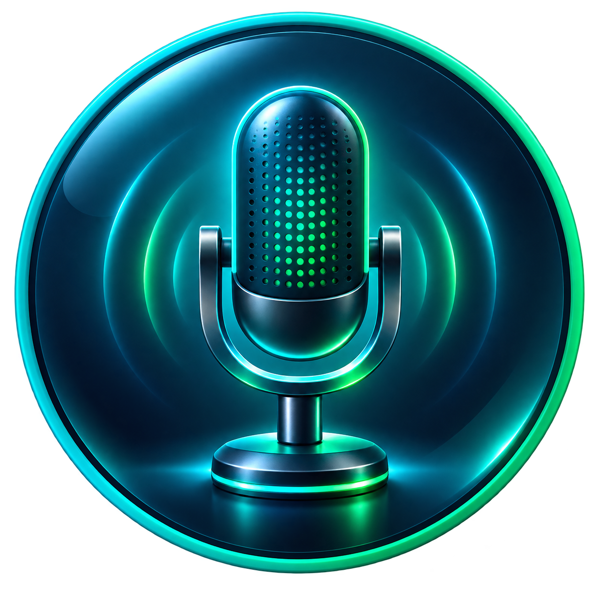
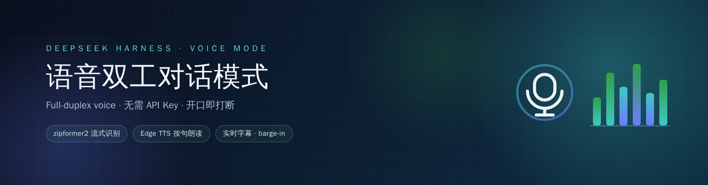
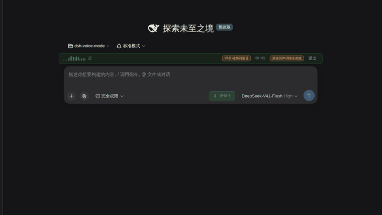
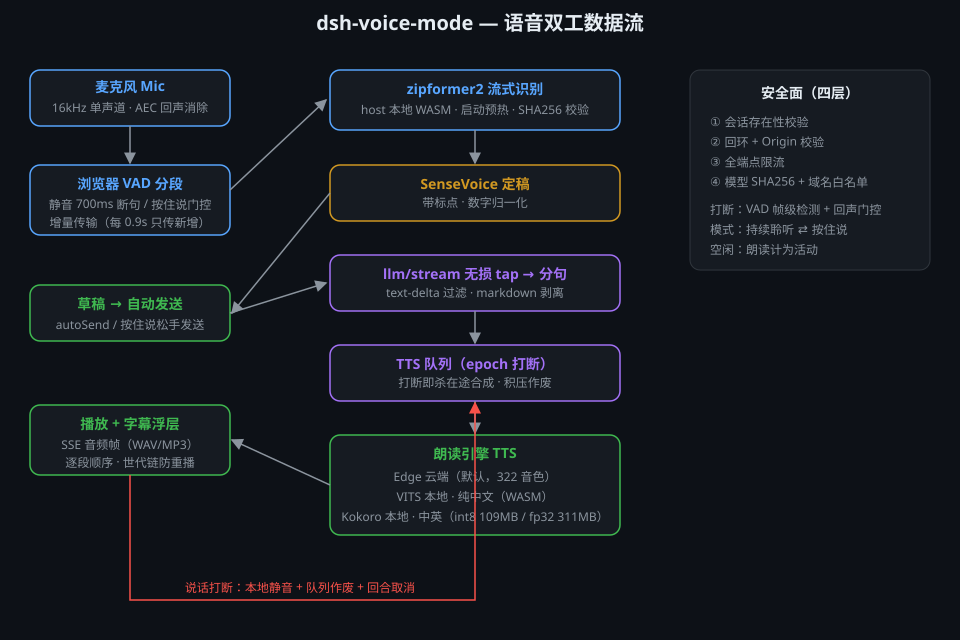
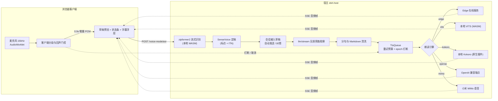

<p align="center">
  
</p>

<h1 align="center">dsh-voice-mode</h1>

<p align="center">DeepSeek Harness 全双工语音对话插件 —— 边说边出字 · 按句朗读 · 发声打断</p>

<p align="center"><b>中文</b> · <a href="plugin/dsh-voice-mode/README.en.md">English</a></p>

<p align="center">
  <a href="LICENSE"></a>
  <a href="https://github.com/qishuilalala/dsh-voice-mode/releases"></a>
  <a href="https://github.com/qishuilalala/dsh-voice-mode/actions/workflows/hol-scanner.yml"></a>
  <a href="https://www.npmjs.com/package/dsh-voice-mode"></a>
  <a href="https://github.com/qishuilalala/dsh-voice-mode/actions/workflows/ci.yml"></a>
</p>



> 在 DeepSeek Harness 会话内提供流式语音输入、草稿回填、按句朗读、实时字幕与发声打断。语音识别在宿主端本地运行；默认朗读使用微软 Edge 在线服务，可选本地离线的 VITS / Kokoro，也可接入 OpenAI 兼容语音接口或小米 MiMo。实际打断与识别表现取决于麦克风、扬声器回声消除及网络环境。

## 当前状态

- **宿主与跨平台兼容**：已对 `dsh 0.1.1-rc.2` 至 `0.2.3-alpha.2` 完成客户端注入锚点、宿主/浏览器双端类型检查与隔离运行态验证；完整版本证据、操作系统/架构/浏览器兼容表及未覆盖边界见[兼容契约](docs/compat-contract.md)。
- **已发布版本**：`v0.7.45` 修复 dsh `0.2.3` 线上首个语音回合失败的问题并适配新宿主鉴权；延续 `v0.7.44` 的宿主入口 TypeScript 声明与双语说明。已发布功能包括 7 家在线 TTS 预设及按预设独立密钥、小米 MiMo 语音合成、识别纠错词表、四分段设置面板和全模式键盘与触屏操作提示。安装版本见 [npm](https://www.npmjs.com/package/dsh-voice-mode) 和 [GitHub Releases](https://github.com/qishuilalala/dsh-voice-mode/releases)。
- **源码中的未发布改动**：共享语音核心与 Markdown 水平线开头的流式朗读修复见[变更日志](CHANGELOG.md#unreleased)。
- **验证边界**：CI 检查覆盖类型、单测、构建产物一致性与全新安装加载，不等同真实麦克风声学或全平台硬件验收；包声明范围为 `>=0.1.1-rc.2 <0.3.0-0`，未列于兼容契约的版本不做兼容承诺。

---

## 核心能力

在任意 DeepSeek Harness 会话中，点击输入框旁的麦克风按钮即可进行语音对话：

- **边说边出字** —— 宿主端本地流式识别（`zipformer2` 流式 + `SenseVoice` 整段标点与数字规范化），无需额外配置语音识别 API Key；默认停顿约 1.5 秒断句写入草稿，再安静约 1.2 秒自动发送（也可关闭自动发送仅作听写）。
- **按句朗读与字幕** —— 模型回复生成过程中按句合成播放，支持 4 档字号、3 档宽度的实时字幕浮层与最近 8 句回看；代码块自动跳过不念。
- **随时打断与让位** —— 朗读期间开口说话可打断播放并保留刚说出的前半句（`bargeInSalvage`）；插话「嗯 / 对」等短应答词可自动暂停让位 1.5 秒后继续朗读（`backchannelYield`）；外放环境下可自动或手动切换为按住麦克风 / `Ctrl` 打断。
- **三种交互模式与五类朗读引擎** —— 支持「持续聆听（`toggle`）」「按住说话（`hold`）」「说完就关（`once`）」；朗读支持默认的 `edge` 云端、本地离线的 `vits`（中文）/ `kokoro`（中英混读，103 音色），以及自备密钥的 `openai` 兼容接口与 `mimo`（小米 MiMo）。

### 解决的核心问题

| 常见痛点 | 本插件处理方式 |
| --- | --- |
| 朗读字幕字号偏小、窄屏遮挡输入框 | 提供 4 档字号（12/14/18/24px）、3 档最大宽度（50/70/90vw）及移动端安全区避让，播毕支持展开回看 |
| 外放漏声自打断，或附和一声「嗯」就打断整段回复 | 默认探测浏览器原生回声消除（未生效时朗读期自动改用长按打断），并提供短词让位与三档打断灵敏度 |
| 打断瞬间说的头几个字被吞掉 | 播放期维护 2 秒回声消除后预录环，确认打断时自动拼回语音起点前 250ms 的内容 |
| 专有名词或中英混说总被听成同音错字 | 支持在设置面板维护识别后替换词表（`asrReplacements`），可选开启发送前大模型轻量纠错（`llmCorrect`） |

---

## 界面演示



**麦克风按钮状态指示与快捷菜单**（社区贡献 [@dyguests](https://github.com/dyguests)，PR #16 / #17）：聆听时绿色音柱随音量跳动、朗读时蓝色音柱、按住说话时红色高亮、「说完就关」等待回复时转圈。桌面端**右键点击按钮**、触屏端点击按钮旁 **`⋯`**（或空闲非按住态长按 0.45 秒）即可打开快捷菜单；关闭状态条与字幕后，全部语音状态均可收拢到单个按钮上：


---

## 快速开始

首次进入语音模式会自动下载本地识别模型（约 160MB 流式模型 + 可选约 228MB SenseVoice 定稿模型，支持断点续传；中国大陆网络可在设置中将模型镜像设为 `https://hf-mirror.com`）。宿主自身的对话大模型仍需按常规配置。

```sh
dsh plugin --profile web add dsh-voice-mode
# 如安装在其他 profile（如桌面端 desktop），请将 web 替换为实际 profile 名称，安装后重启宿主生效
```

### 操作手势与快捷键（Windows / Linux 与 macOS 对照）

| 操作场景 | Windows / Linux | macOS | 行为说明 |
| --- | --- | --- | --- |
| 进入 / 退出语音模式 | `Ctrl+Shift+V` | `⌃ Control + ⇧ Shift + V` | 应用内全局切换（注意 macOS 默认使用 `Control` 而非 `⌘ Command`）；可在设置「快捷键」中点「录制」改键或留空停用 |
| 输入框内切换语音模式 | `Alt+Enter` | `⌥ Option + Return` | 光标在聊天输入框内时直接进入或退出语音模式，不插入换行，不影响 `Ctrl/⌘ + Enter` 发送 |
| 持续聆听（`toggle`，默认） | 直接说话；说话时按住 `Ctrl` 立即发 | 直接说话；说话时按住 `⌃ Control` 立即发 | 停顿约 1.5 秒断句写入草稿，再静音约 1.2 秒自动发送；说话中按住 `Ctrl` / `⌃ Control` ≥0.25 秒松开可立即发送 |
| 按住说话（`hold`）—— 鼠标/触屏 | 按住麦克风按钮说话，松开发送 | 按住麦克风按钮说话，松开发送 | **未进入语音模式时也可直接按住麦克风按钮开录**，松手发送并在本轮回复结束后自动退出；按住期间上滑指针可取消 |
| 按住说话（`hold`）—— 键盘 | 进入语音模式后长按 `Ctrl`（≥0.22 秒） | 进入语音模式后长按 `⌃ Control`（≥0.22 秒） | 按住期间持续收音、停顿不断句，松开立即定稿发送；按 `Esc`、切走窗口或组合按其他键会自动取消本段 |
| 说完就关（`once`） | 说完一句自动停麦，播完自动退出 | 说完一句自动停麦，播完自动退出 | 适合单轮提问；朗读期间按住麦克风或 `Ctrl` / `⌃ Control` 打断后会恢复收音并留在语音模式 |
| 打断或停止朗读 | 开口说话 / 按 `Esc` | 开口说话 / 按 `Esc` | 自动打断下开口即停；手动打断（`manual`）下朗读期按住麦克风或 `Ctrl` / `⌃ Control` 打断；按一次 `Esc` 停播，连按两次 `Esc` 退出语音模式 |
| 快捷菜单 | 右键点击麦克风按钮（或菜单键） | 右键 / 双指点按麦克风按钮 | 触屏设备可点麦克风旁 `⋯` 按钮（或空闲非按住态长按 0.45 秒），快速切换交互模式、朗读范围、字幕、状态条与自动发送 |

---

## 配置说明

**所有 dsh 版本通用入口：设置（Settings）→ 语音模式（Voice Mode）**——插件在宿主设置弹窗内注册了独立设置页。按宿主版本另有次要入口：

| dsh 版本 | 次要入口 | 设置存放位置 |
| --- | --- | --- |
| ≤ 0.1.5 | 设置 → Plugins → 插件配置 → 语音模式 | dsh 官方设置存储 |
| ≥ 0.1.6-alpha | 左侧 **Plugins** → 已安装的 `dsh-voice-mode` → 详情页「语音模式」卡片 | 0.1.6：官方设置存储；0.1.7+：插件覆盖层文件 `$DSH_HOME/voice-mode.settings.json`（权限 `0600`） |

设置面板分为四个标签页：① **语音输入**（交互模式、唤醒词、自动发送、打断方式与灵敏度、静音停顿、快捷键录制）② **朗读**（朗读范围、引擎选择、在线预设与独立 API Key、音色试听、语速、「测试朗读」）③ **显示与交互**（字幕字号/宽度、状态条、切回自动恢复、工具提示音、空闲超时）④ **高级**（SenseVoice 定稿、数字规范化、口语化提示词、让位窗口、打断语音抢救、大模型纠错、纠错词表、模型镜像与缓存管理）。

**生效时机分四档**：① 即时生效（快捷键、交互模式、朗读范围、自动发送、字幕与状态条开关、朗读引擎/预设/音色/语速、纠错词表、口语化提示词、模型镜像）② 下次识别生效（SenseVoice 定稿重译、逆文本归一化）③ 下一段话生效（静音判定时长）④ 下次进入语音模式生效（其余声学门控、唤醒词、字号宽度与空闲超时等）。设置面板顶部会提示「已保存但尚未生效」的项及其**当前生效值**。

完整 **36 项设置键说明表**、在线 TTS YAML 示例与 HTTP 路由定义见 [插件详细文档（中文）](plugin/dsh-voice-mode/README.md) 与 [English Documentation](plugin/dsh-voice-mode/README.en.md)。

---

## 架构概览





关键架构取舍记录在 [`docs/adr/`](docs/adr/README.md)（共 15 篇 ADR）。

---

## 常见问题排查

| 现象 | 排查与处理方式 |
| --- | --- |
| 点击麦克风无反应，状态条红字报错 | 浏览器未授予麦克风权限，或通过非 HTTPS 的局域网 IP 访问（浏览器要求 `localhost` 或 HTTPS 安全上下文才开放麦克风） |
| 按住说话不知道按哪个键（尤其是 Mac） | 可直接用鼠标/触屏**按住麦克风按钮**说话；若用键盘，请先点麦克风进入语音模式，再**长按左/右 `⌃ Control` 键**（Mac 上不是 `⌘ Command`）说话、松开发送 |
| 状态条卡在「正在加载模型… x%」 | 首次使用需下载识别模型；中国大陆网络可在设置「高级 → 模型镜像」中选 `https://hf-mirror.com`，或在插件目录运行 `npm run prefetch` 预下载 |
| 默认 Edge 朗读无声或提示暂不可用 | Edge 朗读依赖微软在线接口与外网连通；可在设置「朗读」页点击「测试朗读」查看具体原因，或一键切换到离线本地引擎 `VITS` / `Kokoro` 及已配密钥的在线预设 |
| 桌面端（Electron）选择本地 Kokoro 提示需要 Node.js | Electron 内置 V8 限制了 `sherpa-onnx-node` 原生外部缓冲区，插件会自动调用系统 `PATH` 上的独立 `Node.js ≥ 18`（也可通过环境变量 `DSHVM_NODE` 指定路径）；未装独立 Node 时可改用 `Edge` 或本地 `VITS` |
| 扬声器外放时容易误打断或打不断 | 默认 `detect` 会在检测不到浏览器回声消除时将朗读期切为长按打断；仍受外放音量影响时，可将「打断方式」设为 `manual`（空闲正常说话，朗读期按住麦克风或 `Ctrl` 打断），或佩戴耳机 |
| 空闲 5 分钟后自动退出语音模式 | 可在「显示与交互 → 空闲超时」调大 `idleTimeoutMinutes`（正在朗读、AI 回复生成中均自动续期，不计为空闲） |

报告问题时，可进入语音模式，在输入框上方状态条点击「复制诊断」。若状态条已隐藏，在「设置 → 语音模式 → 显示与交互」打开状态条。诊断中的 `build=` 是构建提交哈希，安装版本可在宿主的已安装插件详情查看。

---

## 文档导航

| 文档 | 内容 |
| --- | --- |
| [插件完整文档（中文）](plugin/dsh-voice-mode/README.md) | 全量 36 项设置表、在线预设与本地模型配置、API 路由、权限与数据流声明、开发说明 |
| [English Documentation](plugin/dsh-voice-mode/README.en.md) | Full user, configuration, privacy, and developer guide in English |
| [兼容契约](docs/compat-contract.md) | 已验证 `dsh` 版本矩阵、操作系统/架构/浏览器支持情况与未覆盖说明 |
| [文档总索引](docs/README.md) | 架构决策（ADR 0001–0015）、路线图、测试体系与历史归档入口 |
| [CHANGELOG.md](CHANGELOG.md) | 各版本变更记录 |
| [贡献指南](CONTRIBUTING.md) | 源码构建、自动化检查、问题报告与发布检查 |
| [SECURITY.md](SECURITY.md) | 安全策略、数据边界与私密漏洞报告方式 |

---

## 参与贡献、许可证与致谢

- **贡献指南与行为准则**：提交 Issue 或 Pull Request 前请阅读 [CONTRIBUTING.md](CONTRIBUTING.md) 与 [CODE_OF_CONDUCT.md](CODE_OF_CONDUCT.md)，架构背景见 [CONTEXT.md](CONTEXT.md) 与 [docs/adr/](docs/adr/README.md)。
- **开源许可**：[MIT License](LICENSE)（第三方内联依赖声明见 [THIRD_PARTY_NOTICES.md](plugin/dsh-voice-mode/THIRD_PARTY_NOTICES.md)，首次运行时按需下载的语音模型遵循其各自上游许可证）。
- **致谢**：
  - 早期上游项目：[haoku123/dsh-voice](https://github.com/haoku123/dsh-voice)
  - 核心语音组件：[sherpa-onnx](https://github.com/k2-fsa/sherpa-onnx)（Apache-2.0，本地流式 ASR / SenseVoice / VITS / Kokoro 推理）、[msedge-tts](https://github.com/Migushthe2nd/MsEdgeTTS)（Edge 在线合成）
  - 社区贡献与收录：感谢 [@dyguests](https://github.com/dyguests) 等社区贡献者，以及 [awesome-dsh-plugin](https://github.com/awesome-dsh-plugin/awesome-dsh-plugin) 收录支持
