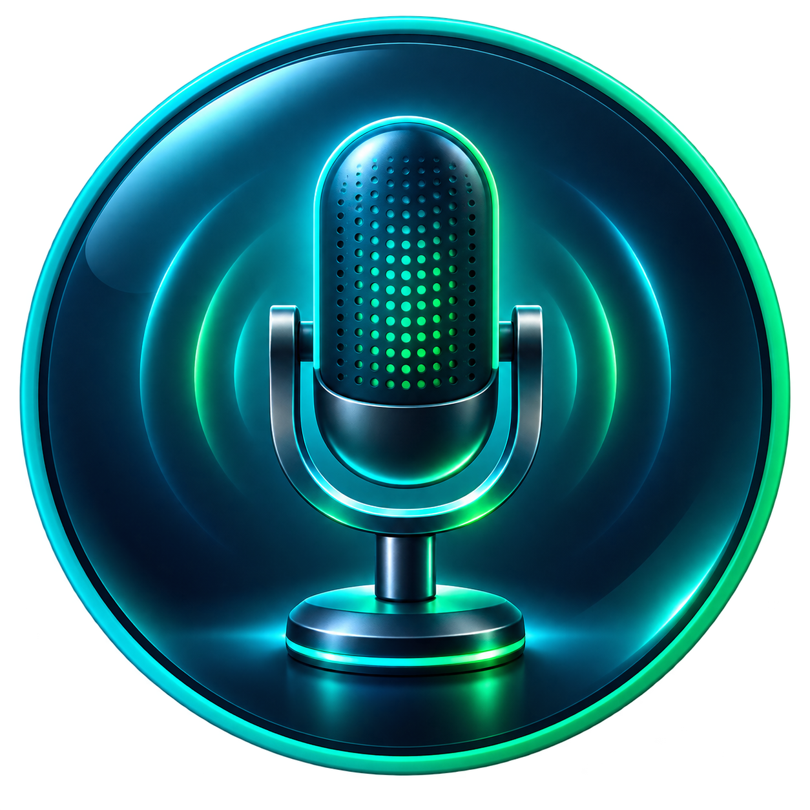
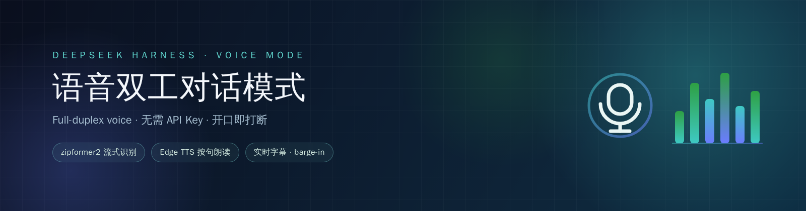
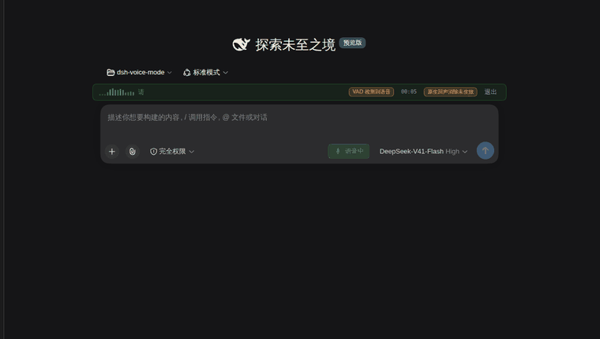
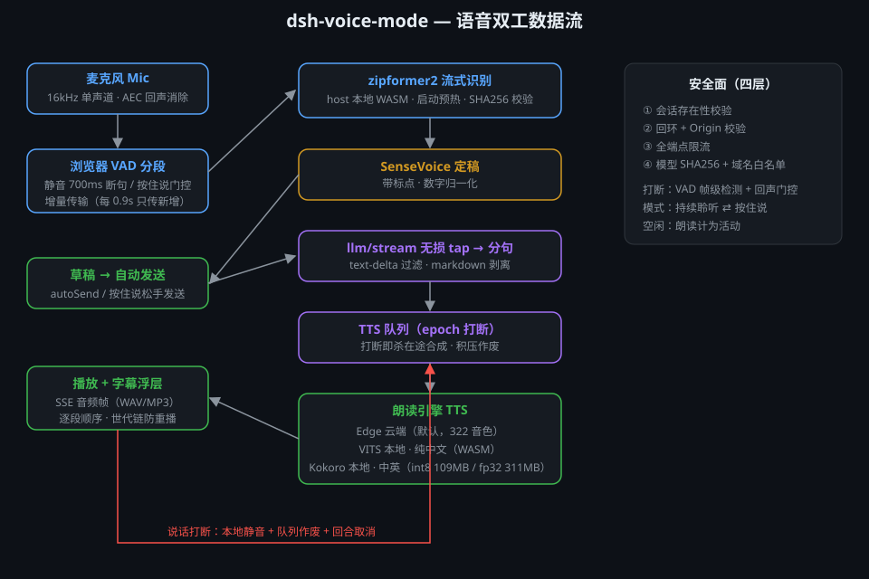
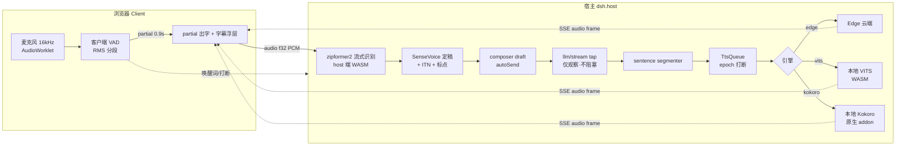

<p align="center">
  
</p>

<h1 align="center">dsh-voice-mode</h1>

<p align="center">DeepSeek Harness 全双工语音插件 —— 边说边出字 · 按句朗读 · 发声打断</p>

<p align="center"><b>中文</b> · <a href="plugin/dsh-voice-mode/README.en.md">English</a></p>

<p align="center">
  <a href="LICENSE"></a>
  <a href="https://github.com/qishuilalala/dsh-voice-mode/releases"></a>

  <a href="https://github.com/qishuilalala/dsh-voice-mode/actions/workflows/hol-scanner.yml"></a>
  <a href="https://www.npmjs.com/package/dsh-voice-mode"></a>
  <a href="https://github.com/qishuilalala/dsh-voice-mode/actions/workflows/ci.yml"></a>
</p>



> 在 DeepSeek Harness 会话内进行语音输入、编辑草稿和按句朗读，支持字幕及发声打断。识别在宿主端推理；默认 Edge 朗读访问微软在线服务，本地 VITS / Kokoro 可选。自动发送和打断行为可在设置中调整，实际效果取决于模型、设备、回声消除和网络。

## 当前状态（2026-10-28）

兼容跟进（2026-10-30）：已对最新 dsh 0.2.1-rc.5 完成锚点、类型和隔离运行时复核，详见[兼容契约](docs/compat-contract.md)；这不等同真实麦克风或全平台验收。

- **v0.7.34 补丁版**：修复 Kokoro 主模型及固定摘要支持文件因上游替换而下载校验失败的问题；可安装版本以 [npm](https://www.npmjs.com/package/dsh-voice-mode) 与 [Releases](https://github.com/qishuilalala/dsh-voice-mode/releases) 为准。
- **升级提示**：v0.7.33 不包含这项下载修复。v0.7.34 使用与既有摘要匹配的上游历史版本，不改模型、音色或缓存目录；请勿关闭摘要校验。
- **能力与验证分开**：CI 徽章展示对应分支的检查结果；真实听感、麦克风闭环和跨平台仍有未验收项。没有“所有设备都能精准打断”或“后续所有宿主版本兼容”的承诺。
- **后续路线**：[当前路线图](docs/plan/roadmap-2026-10.md)；具体发布变化见 [CHANGELOG](CHANGELOG.md)，历史验证见[兼容契约](docs/compat-contract.md)。


---

## 💡 它是什么

在 DeepSeek Harness 的会话里，点一下麦克风就能用语音完成整轮对话：

- 🎤 **你说** —— 一边说一边**实时出字**（流式识别），停顿约 **1500ms 断句进草稿**，再静音约 1.2 秒（合计约 2.7 秒）自动发送；
- 🔊 **它答** —— 最终回复**按句朗读**，全程实时字幕跟随；
- ⏸️ **随时打断** —— 朗读时可发声打断；效果受设备、回声消除和噪声影响，必要时使用按住说话。

宿主 LLM 的密钥、网络与费用由宿主配置决定。

**无需额外语音 API Key**：识别在宿主端**本地推理**（**zipformer2** 流式 + SenseVoice 定稿）；朗读默认 **Edge 云端**（快、自然），可选本地 **VITS** 纯中文 / **Kokoro** 中英混读（合成在宿主端完成，不向独立在线 TTS 服务发送文本）。

---

## 🆕 发布记录摘录（历史）

**v0.7.31 —— 修复 Edge 云端朗读再次失效**（详见 [CHANGELOG](CHANGELOG.md)）
- 🔊 微软又改了 Edge 朗读的握手（2026-10-25 起），0.7.24 ~ 0.7.30 的默认朗读会整体无声；本版跟进上游修复并重建发布包，**已实测合成成功**。本地 VITS / Kokoro 朗读不受影响
- 🔐 依赖审计：修复 zod 高危公告（GHSA-mrhx-c7xc-m3w5），该依赖仅用于开发期类型检查、不进发布包

**v0.7.30 —— 兼容 dsh 0.2.1-rc.3**
- 🧩 覆盖矩阵扩到 18 个宿主版本 / 15 个隔离核心冒烟；兼容声明（中英 README、manifest）同步到 0.2.1-rc.3

**v0.7.29 —— 对抗验证修复批**（详见 [CHANGELOG](CHANGELOG.md)）
- 🧩 长句还在识别时接着说下一句，前一句不再被吞；朗读中按住打断再上滑取消后，下一句不再丢
- ⏱️ 长朗读、长工具回合不再被「空闲退出」掐断（距最后一次真实操作满 2 小时才退出）
- 🔤 回复含 `&`、`<`、`>` 时 Edge 朗读不再整句跳过；本地 Kokoro 下载完成后可完全离线
- 🌐 模型下载卡住 120 秒自动换源；点麦克风转圈时再点一次即取消，8 秒无应答自动收尾
- ♿ 读屏软件只播报状态变化，不再被实时转写和计时刷屏

**v0.7.28 —— 输入框内快捷键与按住说话优化**（社区贡献 [@dyguests](https://github.com/dyguests)，PR #17）
- ⌨️ 光标在输入框里按 **`Alt+Enter`**（Mac 为 `Option+Enter`）即可进入 / 退出语音模式，不会插入换行；可在设置里改键或留空禁用
- 🎙️ 设置新增「快捷键」分组：点「录制」直接按组合键录入，`Esc` 取消、`Backspace` 清空，缺修饰键或不支持的键会提示；改完**立即生效**，不用刷新
- ✋ 按住说话：空闲时直接按住就开始录；松手发送后等回复读完自动退出；点麦克风按钮不再抢走输入框光标
- 🔊 没有句末标点的长文字（含英文）朗读分段更自然，打断更及时

**v0.7.27 —— 麦克风按钮即状态面板**（社区贡献 [@dyguests](https://github.com/dyguests)，PR #16）
- 🎛️ 按钮挂到发送键旁，状态全写在按钮上：聆听绿条、朗读蓝条随音量跳动，出错红点、说话橙点；**右键**一键切交互模式 / 朗读范围 / 字幕 / 状态条
- 🔁 **说完就关**（`mode: once`）：说一句 → 自动发送 → 读完回复 → 自动退出，适合偶尔问一句
- 📖 **总是朗读**（`readAloud: always`）：打字发的消息也读出来；代码块自动跳过；点一下按钮就停

---

## 🤔 为什么值得用（3 个真痛点）

| # | 痛点 | 我们的应对 |
| --- | --- | --- |
| 1 | **字幕看不清** —— 字小、窄屏被输入框挡住 | `captionFontSize` 4 档（12/14/18/24px）+ `captionMaxWidth` 3 档（50/70/90vw） |
| 2 | **让位误打断** —— AI 朗读时插一句「嗯/对」就被硬打断 | `backchannelYield` 让位语义：短词自动让位 1.5s，真要说走才硬打断 |
| 3 | **本地 TTS 太机械** —— 一句话读完停顿 3-5 秒 | VITS 使用 WASM、Kokoro 使用原生 addon，并在子进程合成；按句排队播放，间隔依赖模型和硬件 |

---

## ✨ 功能（按用户价值）

1. 🎙️ **识别准** —— SenseVoice 多语种定稿 + ITN（数字/日期/货币自动规范化）
2. 🗣️ **不说错** —— 唤醒词待机、唤醒词前缀语气词白名单（`嗯`/`那个` 不再误触）
3. 🤝 **让位** —— 让位语义 + 三档打断灵敏度（`interruptLevel`），外放效果取决于设备和回声消除，必要时用按住说话
4. 💬 **有感情** —— 提供内置音色列表和试听；Edge 可用音色随在线服务变化，失败会提示
5. 👁️ **字幕 a11y** —— 4 档字号 + 3 档宽度，浅色主题变量跟随 dsh 主题
6. ✋ **打断不吃句** —— 朗读中开口打断，打断前说的话自动并入识别；任务运行中开口直接插话
7. 🔁 **三种交互** —— 持续聆听 / 按住说话 / 说完就关；朗读范围可选语音模式 / 总是 / 关闭

---

## 🎬 Demo



**麦克风按钮即状态面板**（[@dyguests](https://github.com/dyguests) 贡献，PR #16）：聆听时绿色竖条随音量跳动、朗读时蓝色竖条、「说完就关」等回复时转圈、收尾对勾；右键可切换交互模式 / 朗读范围 / 字幕 / 状态条 / 自动发送。在右键菜单关掉状态条与字幕后，语音 UI 全部收进按钮（下图即此形态）：


> 上图为**界面的真实录制示例**（由 `screenshots/scripts/capture-demo.mjs` 驱动真实链路产出，非 UI 摆拍；UI 持续演进，以实际界面为准）。设置面板见 [使用说明](plugin/dsh-voice-mode/README.md)。

---

## 🚀 快速开始（Quick Start）

首次需要下载模型，耗时随网络与硬件变化；宿主 LLM 仍需单独配置。

```sh
dsh plugin --profile web add dsh-voice-mode
# 安装到 web profile 后，按实际部署方式重启宿主
```

**第一次用**：

1. 进入任一会话，按 `Ctrl+Shift+V`（或点输入区麦克风按钮）进入语音模式，状态条显示「聆听中…」；
2. 说一句完整的话（如「帮我看看今天的天气」）→ 实时字幕立即出现，停顿后断句进草稿、再静音片刻自动发送；
3. AI 回复开始朗读时，尝试发声打断，检查朗读是否停止及后续转写；设备上不可靠时使用按住说话。

### 操作手势

| 手势 | 作用 |
| --- | --- |
| `Ctrl+Shift+V` | 进入 / 退出语音模式（应用内，可改） |
| 输入框内 `Alt+Enter`（Mac 为 `Option+Enter`） | 光标在输入框里时进入 / 退出语音模式，不插入换行（设置 `composerShortcut`，留空禁用；`Cmd/Ctrl+Enter` 仍是发送） |
| 直接说话（toggle） | 边说边出字，停顿约 1500ms 断句进草稿、再静音约 1.2 秒（合计约 2.7 秒）自动发送；按住 `Ctrl` 强制立即发送 |
| 按住麦克风按钮（hold） | 空闲时直接按住就开始录音（短按仍是进入）；松手发送，等回复结束（开朗读则读完）自动退出语音模式；关闭自动发送时松手只把文字留在输入框并直接退出；按住没说话约 25 秒后自动退出；滑出 / `Esc` / 失焦放弃本段。等待或朗读期间单击麦克风 = 停止朗读并完全退出 |
| 点输入框旁模式按钮 | 在「持续聆听 ⇄ 按住说」间切换（保存到设置） |
| AI 朗读时开口说话 | 打断朗读并取消当前回合 |
| 点状态条「退出」 | 退出语音模式 |
| 点字幕浮层「跳过」 | 跳过当前句朗读 |

---

## ⚙️ 配置

**所有 dsh 版本通用入口：设置（Settings）→ 语音模式（Voice Mode）**——插件在 Settings 弹窗里注册了专属设置页。另有按版本不同的次要入口：

| dsh 版本 | 次要入口 | 设置存放 |
| --- | --- | --- |
| ≤ 0.1.5 | 设置 → Plugins → 插件配置 → 语音模式 | dsh 官方设置存储 |
| 0.1.6-alpha 及以后 | 左侧 **Plugins** → 已安装的 `dsh-voice-mode` → 详情页「语音模式」卡片 | 0.1.6：dsh 官方设置存储；0.1.7+（含 0.2.0）：插件自有文件 `~/.dsh/voice-mode.settings.json`（`$DSH_HOME` 下） |

0.1.7+ 说明：官方设置存储不接受本插件条目的写入，故卡片改写插件自己的覆盖层文件——**优先级高于 profile 配置里的同名键**；要恢复为 profile 配置/默认值，把文件内容改成 `{}`（不要删除——首次运行会从旧 `settings.yaml(.imported)` 的 `voice-mode:` 段迁移一次，删除会触发再次迁移）；重装或升级插件不丢设置；某个键在升级后变为非法值时仅该键回落默认。

**生效时机分四档**：① 即时（快捷键/交互模式/朗读范围/自动发送/字幕/状态条、朗读引擎/音色/语速/口语化提示词/模型镜像）② 下次识别时（定稿重译/逆文本归一化）③ 下一段话（静音判定时长）④ 下次进入语音模式（其余大部分）。设置卡片顶部会列出「已保存但未生效」的项及其**当前生效值**——改完没立刻生效先看这里。

### 常用设置键

| 你想调什么 | 改哪个键 | 默认 | 说明 |
| --- | --- | --- | --- |
| 逆文本归一化 | `senseITN` | `true` | SenseVoice 数字/日期/货币规范化（默认开，关掉保留原文） |
| 字幕字号 | `captionFontSize` | `0` | 档位 0=12px / 1=14px / 2=18px / 3=24px |
| 字幕宽度 | `captionMaxWidth` | `1` | 档位 0=50vw / 1=70vw / 2=90vw |
| 让位语义 | `backchannelYield` | `true` | 朗读期说「嗯/对」自动让位 1.5s，真要说走硬打断（ADR-0008） |
| 静音断句 | `silenceMs` | `1500` | 停顿多久定稿（毫秒） |
| 输入框内快捷键 | `composerShortcut` | `Alt+Enter` | 光标在输入框里时切换语音模式、不插入换行（Mac 为 Option+Enter）；留空禁用；可点「录制」直接按键录入 |
| 语速 / 空闲退出 | `rate` / `idleTimeoutMinutes` | `1.1` / `5` | Edge 语速倍率；空闲分钟数（朗读计为活动） |

> 字段名保持向后兼容，旧 `~/.dsh/settings.yaml` 可直接沿用。

完整 29 项设置表见 [使用说明 · 设置](plugin/dsh-voice-mode/README.md)。

---

## 🏛️ 架构（Architecture）





详细架构决策：见 [`docs/adr/`](docs/adr/README.md) 12 个 ADR。

---

## 🔍 与早期上游实现的历史对照

| 维度 | 早期上游（历史） | dsh-voice-mode（本插件） |
| --- | --- | --- |
| 识别模型 | 云端 API（需 key） | **本地 zipformer2 + SenseVoice**（零 key） |
| 多语种 | 英文为主 | **SenseVoice 自动识别（zh/en/ja/ko/yue）+ ITN** |
| 朗读引擎 | 云端 TTS | **Edge 云端 + 本地 VITS/Kokoro** 三选一 |
| 打断检测 | 基础 VAD | **三档灵敏度 + 回声门控 + 让位语义** |
| 字幕 a11y | 无 | **4 档字号 + 3 档宽度 + 主题跟随** |
| 唤醒词 | 无 | **轻量流式匹配 + 前缀语气词白名单** |
| 兼容 dsh | — | 声明范围 `>=0.1.1-rc.2 <0.3.0-0`；已测版本见兼容契约，未测版本不保证 |

---

## 🛠️ 故障排查

| 现象 | 处理 |
| --- | --- |
| 点麦克风无反应，状态条红字 | 浏览器拒绝麦克风：地址栏（iOS 为 设置 → Safari → 麦克风）开启后重试 |
| 状态条「正在加载模型… x%」卡住 | 检查网络；模型较大可先 `npm run prefetch`；国内网络 `modelHost` 配 `https://hf-mirror.com` |
| 朗读无声音 / 无字幕 | 本地引擎首次合成需加载模型；若持续失败看状态条提示（自动退避重试）；确认页面前台且未静音。**默认的 Edge 云端朗读依赖微软在线服务**：若连续多句失败，会提示「云端朗读暂不可用」——本地模型已就绪时可手动切到 VITS / Kokoro；未就绪时保留草稿/纯文本，并检查本页 Kokoro 升级说明（微软已两次变更握手：2026-10-15 起 v0.7.23 及更早版本无声 → 修于 0.7.24；2026-10-25 起 v0.7.24 ~ v0.7.30 无声 → 修于 **0.7.31**，请升级到 ≥0.7.31） |
| 语音模式进不去 | 检查插件 `enabled`；多标签页时确认当前会话为活动会话 |
| 识别到但不是我要说的 | 环境噪声：先减少噪声并对比实时转写和定稿；`interruptLevel` 只影响打断，不提高识别准确率 |
| 打不断（朗读中开口无反应） | 将 `interruptLevel` 向 2 调整（2 最敏感，0 高门槛），检查麦克风/AEC；仍不可靠时使用按住说话。`echoGateDb` 仅在无原生 AEC 时作为兜底 |
| 字幕被输入框挡住 | 默认 `captionMaxWidth=1`（70vw）+ `captionFontSize=0`（12px）在窄屏可能与底部输入框重叠；调整档位，或关闭语音模式后点状态条浮层右上角「×」收起 |
| 让位行为异常（朗读期说「嗯」不停 / 真话被打断） | 「嗯/对」类短词触发让位 1.5s（hold）后继续朗读；继续说真话会走硬打断；如不要让位语义把 `backchannelYield` 关闭即可恢复改造前行为（ADR-0008） |
| 朗读期说「嗯」没让位 | 确认 `backchannelYield=true`（默认开）；hold 模式松手后让位 1.5s 内继续说话会变硬打断 |
| 空闲 5 分钟自动退出（不想退） | 调高 `idleTimeoutMinutes`（默认 5 分钟，**朗读计为活动**） |

> **已知限制**：`Ctrl+Shift+V` 会覆盖浏览器「粘贴纯文本」快捷键（普通粘贴仍用 `Ctrl+V`）；识别为简体中文优先；**Safari / iOS** 需 HTTPS 或 localhost、首次需授权麦克风、后台 / 锁屏会暂停识别与朗读。

---

## 🛣️ 路线图（Roadmap）

[当前路线图](docs/plan/roadmap-2026-10.md)统一记录优先级、候选准入、验收门槛与回滚条件。

1. 先闭环已确认缺陷，验证真实 ASR → 可编辑草稿 → 发送 → TTS。
2. 优先解决丢句、误发、编辑冲突和恢复成本等高损失体验问题。
3. 推进可控的模型更新与回退；新模型或协议只有实测瓶颈证据才进入实验，不承诺必增后端。

客户端 VAD、WebSocket 重写、声音克隆与广泛工具控制不作为已批准的近期工作。[历史 backlog](docs/competitive/backlog.md)保留先前研究，旧 Ready 和估时不构成当前承诺。

---

## 📚 文档

| 文档 | 说明 |
| --- | --- |
| [完整使用说明（中文）](plugin/dsh-voice-mode/README.md) | 功能 / 手势 / 设置 / 配置 / 已知限制 / 故障排查 |
| [English docs](plugin/dsh-voice-mode/README.en.md) | Same, in English |
| [docs/ 索引](docs/README.md) | 架构决策 / 实施计划 / 真机验收 / 规则 / 调研 / 竞品 |
| [60 天迭代博客](blog/2026-09-15-eleven-batches-evolution.md) | 从 91 到 254 项测试的故事（历史计数，非当前门禁结果） |
| [CHANGELOG.md](CHANGELOG.md) | 已发布与 Unreleased 分开记录 |
| [后续路线图](docs/plan/roadmap-2026-10.md) | 优先级、候选准入、验收与回滚 |
| [RELEASE-NOTES.md](RELEASE-NOTES.md) | 历史归档（v0.7.7 60 天时间线 / v0.7.11 五版本实测；**现行发布说明见 CHANGELOG.md**） |

---

## 🤝 Contributing / 📄 License / 🙏 Acknowledgments

贡献前请阅读[贡献指南](CONTRIBUTING.md)。

**License**: [MIT](LICENSE)

**Contributing**: PR 欢迎，但请先读 [`docs/adr/`](docs/adr/README.md) 12 个 ADR + [`CONTEXT.md`](CONTEXT.md) + [`docs/rules/STATE.md`](docs/rules/STATE.md)。

**Acknowledgments**：

- 上游：[haoku123/dsh-voice](https://github.com/haoku123/dsh-voice)（派生声明见子包 LICENSE）
- 核心依赖：[sherpa-onnx](https://github.com/k2-fsa/sherpa-onnx)（Apache-2.0，本地 ASR / VITS / Kokoro 推理）/ [msedge-tts](https://github.com/Migushthe2nd/MsEdgeTTS)（Edge 云端 TTS）
- 测试支持：[awesome-dsh-plugin](https://github.com/awesome-dsh-plugin/awesome-dsh-plugin)（收录到精选列表）
- 11 批次周全修复参与贡献者：见 [`docs/rules/STATE.md`](docs/rules/STATE.md) § 批次进度表

---

> 📌 **项目维护**：仓库遵循「外科手术式改动」纪律 —— 不顺手优化、不重构无关代码、不强推发布历史；每个 commit 单一职责，便于审查与回滚。详见 [`CONTEXT.md`](CONTEXT.md)。