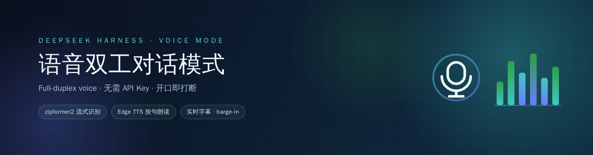
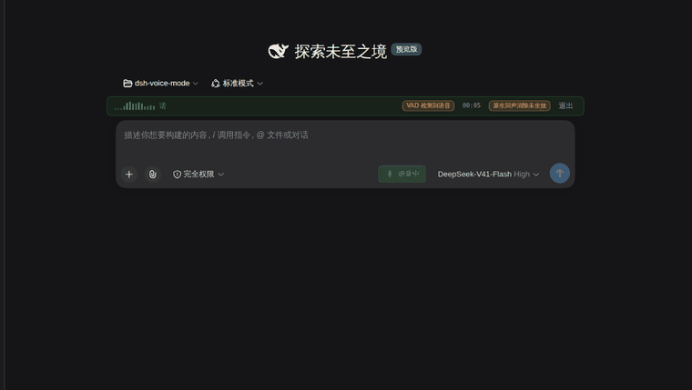
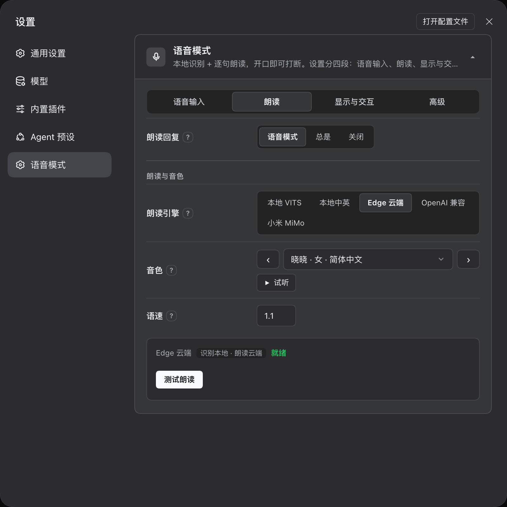
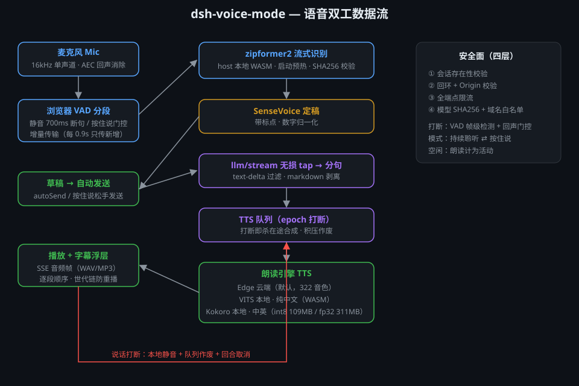

# dsh-voice-mode

[](https://www.npmjs.com/package/dsh-voice-mode)
[](https://www.npmjs.com/package/dsh-voice-mode)
[](https://github.com/qishuilalala/dsh-voice-mode/actions/workflows/hol-scanner.yml)
[](https://github.com/qishuilalala/dsh-voice-mode/actions/workflows/ci.yml)
[](https://github.com/qishuilalala/dsh-voice-mode/blob/main/plugin/dsh-voice-mode/LICENSE)

Full-duplex voice conversation plugin for **DeepSeek Harness (DSH)** across Web and official Desktop: local host-side streaming speech recognition (ASR / STT) into an editable draft, sentence-by-sentence TTS read-aloud with live captions, and instant voice or keyboard barge-in. No extra speech-service API key is required on the default path; the host LLM uses its own configured model and billing.

[简体中文](https://github.com/qishuilalala/dsh-voice-mode/blob/main/plugin/dsh-voice-mode/README.md) · **English** · [Changelog](https://github.com/qishuilalala/dsh-voice-mode/blob/main/CHANGELOG.md) · [Compatibility Contract](https://github.com/qishuilalala/dsh-voice-mode/blob/main/docs/compat-contract.md)



---

## Key Capabilities

- **Host-side streaming speech recognition (ASR / STT)**: runs `zipformer2` streaming recognition and optional `SenseVoice` finalization (punctuation + inverse text normalization) locally via `sherpa-onnx`. Words stream into the composer draft as you speak, split after ~1.5 s of silence, and auto-send after ~1.2 s more quiet (or stay in the draft as dictation when auto-send is off).
- **Three interaction modes**: **Continuous listening (`toggle`)**, **Push-to-talk (`hold`, via pointer/touch on the mic button or holding `Ctrl` / macOS `⌃ Control`)**, and **One-shot (`once`)** — switchable live from Settings, right-click menu, or touch `⋯` menu.
- **Five read-aloud TTS engines**: Microsoft Edge online TTS by default; fully offline local Chinese `vits` and bilingual zh+en `kokoro` (103 voices); 7 built-in OpenAI-compatible online presets (with independent per-preset API keys) plus custom endpoints; and Xiaomi MiMo TTS — with automatic 30-second local fallback on remote timeout or failure.
- **Live caption overlay & compact button UI**: bottom-right caption overlay with 4 font-size tiers, 3 width tiers, mobile safe-area inset handling, and recent 8-sentence history; turning off both the status bar and captions folds all voice indicators, timers, and error badges onto the single mic button.
- **True barge-in & backchannel yielding**: speaking during playback cancels queued audio and the running turn while salvaging the 250 ms pre-onset speech buffer so initial syllables are not swallowed; short backchannels (`right`, `嗯`, `对`) pause playback for 1.5 s instead of aborting the reply; loudspeaker setups without native echo cancellation automatically degrade to hold-to-interrupt.
- **Editable post-ASR replacements & wake word**: maintain custom post-recognition replacement rules with hit counters right inside the Settings panel, with optional pre-send LLM typo correction and standby wake-word activation.




---

## Installation & Quick Start

**Requirements**: DeepSeek Harness `>=0.1.1-rc.2 <0.3.0-0` (verified across client injection anchors, dual host/client typechecks, and isolated runtime smoke tests from `0.1.1-rc.2` through `0.2.3-alpha.2`), Node.js `>=18.0.0`, and a modern browser supporting `getUserMedia` + Web Audio (Chrome / Edge / Firefox / Safari 16+) or the official DSH Desktop app.

```sh
# Option 1: Install from npm (recommended; replace "web" with your target profile if needed)
dsh plugin --profile web add dsh-voice-mode

# Equivalent via npx when the dsh CLI is not installed globally:
npx -y @deepseek-ai/dsh plugin --profile web add dsh-voice-mode

# Option 2: Build and install from source (Node.js 22.18+ on the 22.x line and pnpm 11)
git clone https://github.com/qishuilalala/dsh-voice-mode.git
cd dsh-voice-mode/plugin/dsh-voice-mode
pnpm install --frozen-lockfile
pnpm run build
dsh plugin --profile web add .
```

Restart the DSH host process after installing or updating the bundle. On first entry into voice mode, the plugin lazily downloads the local recognition models (~160 MB streaming model + optional ~228 MB SenseVoice model, with `.part` resume and live progress in the status bar; users in mainland China can set `modelHost` to `https://hf-mirror.com`, or pre-download via `npm run prefetch` inside the package directory).

---

## Gestures & Shortcuts (Windows / Linux vs macOS)

| Action | Windows / Linux | macOS | Behaviour |
| --- | --- | --- | --- |
| Enter / exit voice mode | `Ctrl+Shift+V` | `⌃ Control + ⇧ Shift + V` | App-wide toggle (uses `Control` on macOS by default, not `⌘ Command`; customizable or clearable in Settings → Shortcuts) |
| Toggle from composer | `Alt+Enter` | `⌥ Option + Return` | Toggles voice mode while focused in the chat composer without inserting a newline; leaves `Ctrl/⌘ + Enter` intact for sending |
| Continuous listening (`toggle`) | Speak directly; hold `Ctrl` to send now | Speak directly; hold `⌃ Control` to send now | Splits into draft after ~1500 ms silence and auto-sends after ~1.2 s more quiet; hold `Ctrl` / `⌃ Control` ≥250 ms while speaking to send immediately on release |
| Push-to-talk (`hold`) — pointer/touch | Hold the mic button, release to send | Hold the mic button, release to send | From idle, **hold the mic button directly to start recording**, release to send, and voice mode auto-exits once the reply finishes; swipe up or press `Esc` to cancel |
| Push-to-talk (`hold`) — keyboard | Hold `Ctrl` (≥220 ms) | Hold `⌃ Control` (≥220 ms) | While voice mode is active, hold `Ctrl` / `⌃ Control` to record continuously and release to send; `Esc`, window blur, or pressing another key combo cancels the segment |
| One-shot (`once`) | Speak one turn; auto-exits after reply | Speak one turn; auto-exits after reply | Turns off the mic after sending and exits once read-aloud finishes; holding mic or `Ctrl` / `⌃ Control` during playback interrupts and resumes listening |
| Interrupt / stop reading | Speak / hold `Ctrl` / `Esc` | Speak / hold `⌃ Control` / `Esc` | Under `auto`, speaking interrupts immediately; under `manual` (or `detect` without native AEC), hold mic or `Ctrl` / `⌃ Control` during playback; `Esc` stops reading, double-`Esc` exits |
| Quick settings menu | Right-click mic button (or Menu key) | Right-click / two-finger click mic | On touch devices, tap `⋯` next to the mic (or 450 ms idle long-press outside `hold` mode) to switch modes, read-aloud scope, captions, status bar, and auto-send |

---

## Settings Panel & Full 36-Key Reference

**Universal entry on every DSH version: Settings → Voice Mode**. Secondary entry points by host version:

- `dsh <= 0.1.5`: Settings → Plugins → Plugin config → Voice Mode
- `dsh >= 0.1.6-alpha`: Left sidebar **Plugins** → installed `dsh-voice-mode` → "Voice Mode" card on its detail page (on `0.1.7+`, values persist in `$DSH_HOME/voice-mode.settings.json` with `0600` permissions; to reset to defaults, replace its content with `{}` rather than deleting the file)



### Settings Reference (36 Keys)

| Key | Default | Description |
| --- | --- | --- |
| `ttsEngine` | `edge` | Read-aloud engine: `edge` Microsoft online (default) / `vits` local Chinese / `kokoro` local zh+en / `openai` OpenAI-compatible server / `mimo` Xiaomi MiMo; **applies live** |
| `kokoroModel` | `int8` | Kokoro model precision: `int8` (default, ~109 MB, CPU-friendly) / `fp32` (~311 MB, higher fidelity); shares 103 voices; **applies live** |
| `voice` | per engine | Voice id: 5 VITS speakers; 103 Kokoro voices (dropdown + ◀▶ stepper, popular male voices `62/68/75/76` pinned); 322 Edge voices; inline "Preview" button synthesizes a sample live; **applies live** |
| `rate` | `1.1` | Playback speed multiplier (`0.5` slow – `2.0` fast); **applies live** |
| `interruptLevel` | `0` | Barge-in sensitivity (host VAD frame count + echo gate): `0` high threshold (3 frames) / `1` medium (2 frames) / `2` low (1 frame) |
| `bargeInMode` | `detect` | Barge-in mode: `detect` probes native browser echo cancellation (falls back to hold-to-interrupt during playback when inactive) / `auto` speak-to-interrupt (headphones) / `manual` hold mic or `Ctrl` to interrupt (loudspeakers) |
| `echoGateDb` | `6` | Fallback echo-gate threshold (`3`–`12` dB) used only when native AEC is unavailable |
| `silenceMs` | `1500` | Silence duration in milliseconds (`500`–`30000`) that ends a spoken sentence |
| `idleTimeoutMinutes` | `5` | Minutes of inactivity before auto-exiting voice mode (`1`–`120`; playback and running turns renew activity, capped at 2 hours) |
| `modelHost` | empty (official) | Model download mirror override (e.g. `https://hf-mirror.com` for mainland China); applies on the next download attempt |
| `autoSend` | `true` | Auto-send after silence (consecutive segments join into one message); when off, transcripts stay in the draft (holding `Ctrl` or releasing in `hold` still sends); **applies live** |
| `autoResume` | `false` | Automatically re-enter voice mode when switching back to your last active voice session (off by default) |
| `mode` | `toggle` | Interaction mode: `toggle` continuous listening / `hold` push-to-talk / `once` single turn then auto-exit; **applies live** |
| `readAloud` | `voice` | Read-aloud scope: `voice` only in voice mode / `always` all replies in the visible session (including typed prompts) / `off` never; **applies live** |
| `showStatusBar` | `true` | Show the voice status bar above the composer; when off, indicators fold onto the mic button; **applies live** |
| `showCaptions` | `true` | Show the floating live caption overlay during playback; **applies live** |
| `shortcut` | `Ctrl+Shift+V` | App-wide shortcut to enter/exit voice mode (modifier + letter/digit/Enter/Space/Tab; supports live recording in Settings, empty = disabled); **applies live** |
| `composerShortcut` | `Alt+Enter` | Shortcut to toggle voice mode while focused in the composer (`Option+Return` on macOS, no newline inserted, empty = disabled); **applies live** |
| `wakeWord` | empty (off) | Standby wake word (e.g. `你好小D`, 3–4 chars recommended): active in `toggle` standby only, can be spoken continuously with the command (prefix stripped), resets to standby after each utterance or barge-in |
| `toolBeep` | `false` | Play a short subtle beep when the agent invokes a tool (off by default) |
| `spokenFormat` | `true` | Inject a spoken-style prompt ("short natural sentences, no Markdown formatting") into active voice-mode replies only; **applies live** |
| `senseVoice` | `true` | Re-transcribe finalized segments with SenseVoice for punctuation and ITN (disabling saves ~228 MB of model downloads and uses streaming zipformer only) |
| `senseITN` | `true` | SenseVoice inverse text normalization (normalizes spoken numbers, dates, and currencies) |
| `openaiPreset` | empty (manual) | Built-in online TTS preset: `siliconflow-cosyvoice2` / `siliconflow-fish` / `openrouter-openai` / `openai-official` / `groq-playai` / `selfhosted-kokoro` / `selfhosted-vllm` (or `custom`); **applies live** |
| `openaiBaseUrl` | empty (preset/config) | Online TTS base URL override (priority: settings panel > preset > bundle config); **applies live** |
| `openaiModel` | empty (preset/config) | Online TTS model override (same priority as `openaiBaseUrl`); **applies live** |
| `openaiApiKey` | empty (config fallback) | Global fallback API key for OpenAI-compatible TTS (`0600` host-only storage, never returned to the browser); **applies live** |
| `openaiApiKeys` | `{}` | Per-preset API key map (`{presetId: key}` stored host-side; switching presets automatically switches keys without 401 mismatches; API exposes booleans only); **applies live** |
| `mimoApiKey` | empty (config fallback) | Dedicated Xiaomi MiMo API key (`api-key` header, isolated from OpenAI keys, host-only `0600` storage); **applies live** |
| `asrReplacements` | `[]` | Post-ASR replacement rules `[{from:[misheard], to:target}]` (up to 200 rules / 12 KB, rewrites partials and finals with hit counters); **applies live** |
| `captionFontSize` | `0` | Caption font-size tier: `0`=12px / `1`=14px / `2`=18px / `3`=24px |
| `captionMaxWidth` | `1` | Caption max-width tier: `0`=50vw / `1`=70vw / `2`=90vw |
| `backchannelYield` | `true` | Backchannel yielding: short acknowledgements during playback pause TTS briefly instead of triggering a hard barge-in |
| `yieldMs` | `1500` | Backchannel yield window in milliseconds (`500`–`3000`) before playback resumes automatically |
| `bargeInSalvage` | `true` | Barge-in speech salvage: merges 250 ms pre-onset audio from the playback ring buffer into the new ASR segment so initial words are preserved |
| `llmCorrect` | `false` | Optional pre-send LLM pass to fix homophones/typos/punctuation using the host's configured model (falls back to raw transcript on error or timeout) |

**Four effect-timing tiers**: ① **Immediate** (shortcuts, interaction mode, read-aloud scope, auto-send, caption/status-bar toggles, TTS engine/preset/keys/voice/rate, replacement rules, spoken-format prompt, model mirror) ② **Next recognition** (SenseVoice finalization, ITN) ③ **Next utterance** (silence threshold) ④ **Next voice-mode entry** (barge-in sensitivity/mode, echo gate, wake word, caption dimensions, idle timeout). Pending changes display a banner at the top of the settings card showing their **current effective values**.

### Local Voices & Common Edge Voices

> **Official Desktop (Electron) note**: Electron's V8 sandbox disallows external native buffers used by Kokoro's addon, so the plugin automatically spawns a system Node.js (`>=18` on `PATH`, or pointed to by `DSHVM_NODE`) for local `kokoro`. If standalone Node.js is not installed, use `edge` or pure-WASM local `vits`.

- **Local VITS (Chinese, 5 speakers)**: `suyingxue`, `gunian`, `fushiyu`, `bingjiao`, `bazong`
- **Local Kokoro (zh+en bilingual, 103 voices)**: pinned male voices `62`, `68`, `75`, `76`; common Mandarin female voices `48` (`zf_xiaobei`), `49` (`zf_xiaoni`), `50` (`zf_xiaoxiao`), `51` (`zf_xiaoyi`)
- **Common Edge ShortNames** (run `node scripts/list-voices.mjs` in the package directory to list all 322 voices):

| Edge ShortName | Description |
| --- | --- |
| `zh-CN-XiaoxiaoNeural` | Xiaoxiao · Mandarin Female (default) |
| `zh-CN-XiaoyiNeural` | Xiaoyi · Mandarin Female |
| `zh-CN-YunxiNeural` | Yunxi · Mandarin Male |
| `zh-CN-YunjianNeural` | Yunjian · Mandarin Male |
| `zh-CN-YunyangNeural` | Yunyang · Mandarin Male |
| `zh-CN-liaoning-XiaobeiNeural` | Xiaobei · Northeastern Mandarin Female |
| `zh-HK-HiuMaanNeural` | HiuMaan · Cantonese Female |
| `zh-TW-HsiaoYuNeural` | HsiaoYu · Taiwanese Mandarin Female |
| `en-US-AriaNeural` | Aria · English Female |
| `en-US-GuyNeural` | Guy · English Male |

---

## Advanced YAML Configuration (`settings.yaml` / `cordis.patch.yml`)

In addition to configuring everything in the GUI Settings panel, you can seed defaults in your host configuration (`enabled`, `cacheDir`, and `allowLan` are host-config-only; runtime settings prioritize the GUI Settings file):

### OpenAI-Compatible TTS (`ttsEngine: openai`)

```yaml
- id: voice-mode
  name: dsh-voice-mode
  config:
    enabled: true
    ttsEngine: openai
    voice: vivian
    openaiTts:
      baseUrl: http://127.0.0.1:8091/v1
      apiKey: ''
      apiKeys:
        siliconflow-cosyvoice2: ''
        openrouter-openai: ''
        openai-official: ''
      model: Qwen/Qwen3-TTS-12Hz-1.7B-CustomVoice
      voice: vivian
      responseFormat: mp3
      timeoutMs: 8000
      fallback: kokoro
      fallbackVoice: zf_xiaobei
      instructions: ''
```

### Xiaomi MiMo TTS (`ttsEngine: mimo`)

Xiaomi MiMo uses `POST /v1/chat/completions` audio output with an `api-key` header and keeps its credential strictly isolated from `openaiTts` (official docs: <https://mimo.mi.com>):

```yaml
- id: voice-mode
  name: dsh-voice-mode
  config:
    ttsEngine: mimo
    voice: 冰糖
    mimoTts:
      apiKey: ''
      baseUrl: https://api.xiaomimimo.com/v1
      model: mimo-v2.5-tts
      voice: mimo_default
      instructions: ''
      responseFormat: wav
      timeoutMs: 8000
      fallback: kokoro
      fallbackVoice: zf_xiaobei
```

### Post-ASR Replacement Rules (`asrReplacements`)

Editable live in **Settings → Voice Mode → Advanced → Recognition replacements** (applies immediately), or seeded in YAML:

```yaml
- id: voice-mode
  name: dsh-voice-mode
  config:
    asrReplacements:
      - from: [ski男, ski 男]
        to: Sakina
```

Rules starting or ending with ASCII letters/digits match whole words only (`sina` will not alter `Sinatra`), while CJK rules match longest-first substrings in a single pass across partial captions, composer drafts, and wake-word checks.

---

## Architecture & Host HTTP Routes



- **Single-active session isolation**: only the session referenced by `activeVoiceSession` engages ASR/TTS; all other sessions pass through `llm/stream` with zero overhead.
- **Lossless stream tap**: observes final answer `text-delta` chunks without blocking chat rendering, skipping reasoning blocks, tool calls, and fenced code blocks.
- **Epoch invalidation**: every barge-in increments the per-session queue epoch and aborts in-flight synthesis so stale audio frames never play.

| Host HTTP Route | Description |
| --- | --- |
| `GET /voice-mode` | Health check returning `{ok, name, enabled, active}` |
| `GET /voice-mode/stream` | SSE stream for audio chunks, session mode sync, model download progress, and error codes |
| `POST /voice-mode/toggle` | Enter or exit voice mode (validates session existence and tab ownership) |
| `POST /voice-mode/asr` | Accepts `16kHz` mono `Float32` PCM deltas and returns streaming transcripts, finals, or VAD speech flags |
| `POST /voice-mode/cancel` | Invalidates the TTS queue and optionally cancels the running agent turn |
| `POST /voice-mode/preview` | Isolated one-shot voice synthesis preview |
| `POST /voice-mode/correct` | Pre-send LLM transcript correction (falls back to original text on failure/timeout) |
| `GET /voice-mode/config` | Client bootstrap configuration snapshot |
| `GET /voice-mode/voices` | Available voice catalog |

---

## Install, Enable & Uninstall

| Stage | Operation |
| --- | --- |
| Install | `dsh plugin --profile web add dsh-voice-mode` (`web` = your profile name; the profile is initialised on first use) |
| Enable | Restart or reload the host, then configure under Settings → Voice Mode. Voice mode is off by default and never changes host behaviour silently |
| Upgrade | Re-run `add` with the target version; browser-side changes apply on page reload, host-side changes need a host restart |
| Uninstall | `dsh plugin --profile web remove dsh-voice-mode`, then restart the host. To remove all traces also delete `$DSH_HOME/voice-mode.settings.json` and the model cache (`~/.cache/dsh-voice-mode/`, or `%LOCALAPPDATA%\dsh-voice-mode\` on Windows) |
| Rollback | Reinstall the previous version (`add dsh-voice-mode@<previous>`) and restart; the settings overlay is plain JSON and reads back directly |

The plugin declares only a `prepack` script (used when packaging from source); installing or removing it runs no lifecycle scripts.

## Permissions, Privacy & Security

| Capability | Plugin Behaviour | Data Destination |
| --- | --- | --- |
| **network** | `edge` sends spoken reply text to Microsoft's Read Aloud service; `openai` / `mimo` send spoken text to your selected preset or custom endpoint; local `vits` / `kokoro` synthesize completely offline after downloading SHA256-pinned models from Hugging Face (or your configured mirror); `/voice-mode/*` binds to host loopback by default | Microphone audio goes only to your connected DSH host for local ASR (no cloud ASR). Chat prompts follow your host LLM setup |
| **fs-read / fs-write** | Reads/writes the model cache (`~/.cache/dsh-voice-mode/models/` on macOS/Linux, `%LOCALAPPDATA%\dsh-voice-mode\models\` on Windows) and `$DSH_HOME/voice-mode.settings.json` (`0600`); **never accesses workspace files** | Local machine |
| **shell (child process)** | Runs local TTS in a dedicated `child_process.fork` worker; under Electron desktop, probes system Node.js for Kokoro; **never interpolates shell strings or user input** | Local machine |
| **env** | Reads path/runtime environment variables (`DSH_HOME`, `LOCALAPPDATA`, `PATH`, optional `DSHVM_NODE`) | Local machine |

- In Voice Mode, select **Copy diagnostics** in the status bar above the chat input. To show the bar, use **Settings → Voice Mode → Display & interaction**. The snapshot includes a build hash, runtime state, selected settings, and any available stage timings. It contains no audio or transcript text. The plugin sends no telemetry.
- API keys are stored host-only (`0600`) and never returned to browsers; third-party notices for bundled code are listed in [THIRD_PARTY_NOTICES.md](https://github.com/qishuilalala/dsh-voice-mode/blob/main/plugin/dsh-voice-mode/THIRD_PARTY_NOTICES.md), and vulnerability reporting is documented in [SECURITY.md](https://github.com/qishuilalala/dsh-voice-mode/blob/main/SECURITY.md).
- Downloaded speech models from the [sherpa-onnx](https://github.com/k2-fsa/sherpa-onnx) ecosystem remain under their upstream model licenses (not covered by this package's MIT license).

---

## Troubleshooting

| Symptom | Resolution |
| --- | --- |
| Clicking mic shows permission denied | Allow microphone access in the browser address bar (or iOS Settings → Safari → Microphone); non-loopback origins require `HTTPS` |
| Model download is slow or stalls | Downloads resume automatically via `.part` files; in mainland China set `modelHost` to `https://hf-mirror.com` in Settings → Advanced |
| Unsure how to trigger push-to-talk | From idle, **hold the mic button directly**; for keyboard push-to-talk, enter voice mode first and hold **`Ctrl` (bottom-left `⌃ Control` on macOS, not `⌘ Command`)** for ≥220 ms until the status bar shows recording |
| Default Edge TTS has no audio | Edge relies on Microsoft's online service; switch to offline local `vits` / `kokoro` or a configured online preset in Settings → Read-aloud (`0.7.23` and earlier are deprecated due to an upstream handshake change — upgrade to latest) |
| Desktop Kokoro asks for Node.js | Install Node.js `>=18` on system `PATH` (or set `DSHVM_NODE`) and restart the desktop app, or switch to `vits` / `edge` |
| Loudspeaker echo interrupts playback | Default `detect` switches to hold-to-interrupt when native AEC is absent; you can also set `bargeInMode` to `manual` or `interruptLevel` to `0` |
| Wake word does not trigger | Ensure interaction mode is `toggle` (`hold` disables wake word); after each utterance or barge-in the session returns to standby — check the live standby transcript in the status bar |

---

## Development & License

Use Node.js 22.18+ on the 22.x line and pnpm 11 for local development. See the [contribution guide](https://github.com/qishuilalala/dsh-voice-mode/blob/main/CONTRIBUTING.md#本地开发) for the full workflow.

```sh
cd plugin/dsh-voice-mode
pnpm install --frozen-lockfile
pnpm run check:lib-drift  # check committed bundles before build overwrites lib
pnpm run build            # builds lib/index.js, lib/index.d.ts, lib/client.js, and workers
pnpm run typecheck        # dual host + browser TypeScript checks
pnpm test                 # unit tests, structure guards, and doc-consistency gates
```

Released under the [MIT License](https://github.com/qishuilalala/dsh-voice-mode/blob/main/plugin/dsh-voice-mode/LICENSE), with early foundations derived from [haoku123/dsh-voice](https://github.com/haoku123/dsh-voice) (MIT).
