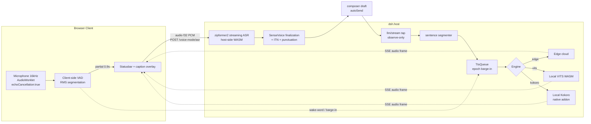

# dsh-voice-mode

[](./LICENSE)
[](https://github.com/qishuilalala/dsh-voice-mode/releases)
[](https://www.npmjs.com/package/dsh-voice-mode)
[](https://github.com/qishuilalala/dsh-voice-mode/actions/workflows/ci.yml)

Full-duplex voice conversation mode for DeepSeek Harness (dsh): speak, get a
spoken answer. Streamed zipformer2 ASR → editable draft → auto send → the
final reply is read out sentence-by-sentence via Edge TTS, and your voice
interrupts playback and the running turn. No additional speech-service API key is needed for the default path; the host LLM has its own configuration and costs.

> **English** · [中文](https://github.com/qishuilalala/dsh-voice-mode/blob/HEAD/plugin/dsh-voice-mode/README.md)


> **Current status (2026-10-28):** npm v0.7.33 is published. v0.7.32 expanded the tested host matrix; v0.7.31 fixed the Edge handshake failure observed then. **Unreleased on main:** Kokoro int8/fp32 models and explicitly hashed support files now use matching historical upstream revisions. npm v0.7.33 does not contain this later download fix. Do not disable checksum verification.
>
> CI results do not establish real-device audio quality or compatibility with every host version. See the [changelog](https://github.com/qishuilalala/dsh-voice-mode/blob/main/CHANGELOG.md), [compatibility evidence](https://github.com/qishuilalala/dsh-voice-mode/blob/main/docs/compat-contract.md), and [roadmap](https://github.com/qishuilalala/dsh-voice-mode/blob/main/docs/plan/roadmap-2026-10.md). The declared dsh range is `>=0.1.1-rc.2 <0.3.0-0`; untested versions are not guaranteed.


---

## 🤝 Fork enhancements (this repo)

- **Edge cloud TTS by default; local TTS optional (privacy-first)**: local VITS (Chinese) and local Kokoro (zh+en, 103 voices; `int8` default ~109 MB / `fp32` ~311 MB with a larger model; native `sherpa-onnx-node` addon, no WASM memory limits) run in an isolated child process;
- **103 Kokoro voices** (F0-measured gender labels, 4 favourite male voices pinned), browsed with a ◀▶ stepper;
- **Delta transport**: partials upload only the new 0.9 s — long push-to-talk segments finalize in seconds;
- **Interaction**: a mode-switch button next to the mic (continuous ⇄ hold, persisted); hold mode records only while held;
- **Long segments**: continuous listening stitches consecutive segments into one message (internally chunked at 30 s and concatenated across chunks); 1500 ms silence split by default; hold keeps pauses from splitting;
- **Hardening**: session-existence check, loopback + Origin guards, endpoint-specific rate limits, pinned digests for primary/listed model files (auxiliary directories use manifest/presence checks), download-host allowlist.

> ℹ️ The `demo-voice-flow.gif` at the top is a **recorded example of the UI** (voice mode → live transcription → pause auto-send → sentence-by-sentence read-aloud with live captions), produced by driving the real pipeline via `screenshots/scripts/capture-demo.mjs`; the UI keeps evolving, so the actual interface prevails.

---

## ✨ Features

- **Voice mode**: toggle with the microphone button in the input toolbar or the global shortcut `Ctrl+Shift+V`; with the caret in the composer, `Alt+Enter` (`Option+Enter` on Mac) toggles it too, without inserting a newline; globally single-active (only one session is in voice mode at a time; switching sessions yields automatically)
- **Three interaction modes (switchable in settings or by right-clicking the mic)**:
  - `toggle` (default) continuous listening: RMS VAD segmentation → streaming zipformer2 ASR (words appear as you speak, live caption preview) → automatic sentence split after 1500 ms of silence into the draft, consecutive segments joined into one message, then auto-sent after ~1.2 s more of silence (≈2.7 s total); hold `Ctrl` to force an immediate send
  - `hold` push-to-talk: from idle, **just hold the mic button to start recording and release to send** (no need to tap in first; a short tap still enters/exits); after sending, voice mode exits on its own once the reply finishes (read aloud, if on); with auto-send off, releasing only leaves the text in the composer (not sent) and exits; if you hold without speaking it exits after ~25 s; (swipe up to cancel, `Esc`/blur abandons the segment; pauses do not split while held, up to 10 min); hold `Ctrl` to record-by-keyboard, release to send
  - `once` one-shot: talk like `toggle`; after sending, the mic turns off and voice mode exits once the reply has been read aloud (with auto-send off: exits after the utterance, text stays in the draft)
- **Read-aloud scope** (`readAloud`): `voice` (default) only replies in voice mode; `always` every reply in the visible session, typed ones included (with the session open in several tabs, only the last-viewed tab plays); `off` never
- **The mic button is the status panel** (PR #16 by [@dyguests](https://github.com/dyguests)): green bars follow your voice while listening, blue bars follow playback while reading, a spinner while `once` waits for the reply, a check mark before it exits; orange dot = speech detected, red dot = error (hover for details). Right-click (or the keyboard menu key) for quick settings; touch long-press stays push-to-talk. Turn off the status bar and captions to keep all voice UI on the button
- **Wake word (optional, off by default)**: after setting `wakeWord`, entering voice mode starts in standby, and recognition only begins once the wake word is spoken (e.g. `你好小D`). **You may say it together with your command** ("wake word, check the weather") — the wake word is stripped from the transcript/caption and never sent; matching is fault-tolerant (homophone substitutions, a wrong first char, leading fillers); 3-4 characters recommended; in standby the status bar live-shows "say '<word>' · what it heard". Boundaries (important): **toggle mode only** (inactive with `hold` / manual barge-in); **it must be repeated after each completed utterance or barge-in** (if you only said the wake word, the engine keeps listening so you may pause before the command); **saying it while the agent is reading does not trigger** (barge-in is VAD-based and unrelated to the wake word)
- **Caption tiers (batch 3)**: `captionFontSize` 4 levels (0=12px / 1=14px / 2=18px / 3=24px) + `captionMaxWidth` 3 levels (0=50vw / 1=70vw / 2=90vw); adapts to narrow viewports
- **Yield semantics (ADR-0008)**: `backchannelYield` on by default — saying `嗯 / 对 / right` while the AI is reading auto-pauses for 1.5 s; genuine speech still triggers hard barge-in; lets the LLM yield the turn
- **Output pipeline**: only the final answer's `text-delta` is read (reasoning/tool calls are skipped), streamed sentence-by-sentence (Edge cloud by default; local VITS / Kokoro, int8/fp32, optional) with a live caption overlay at the bottom-right; tool calls trigger a beep; the full text is still written to the chat; in voice mode a spoken-format system prompt is injected (short natural sentences, no Markdown decoration), and the reader side strips markers as well for a smoother listening experience
- **Barge-in**: three sensitivity levels of voice-onset detection → local mute + host synth queue invalidation (epoch) + running turn cancellation (the half-finished part is kept and naturally flows into your new message). With a wake word set, barge-in **remains speak-to-interrupt** (the gate is the VAD, not the wake word; the engine returns to standby afterwards)
- **Lazy model download with progress**: the zipformer2 Chinese streaming model (~160 MB, `.part` resumable) is downloaded on first use with live progress in the status bar; `npm run prefetch` can pre-download it
- **Resilience and diagnostics**: mic-denied red hint, visible model-download failure, TTS unreachable status hint (auto retry), failed submit keeps the text in the draft, SSE auto-reconnect; the status bar also hints when the recognition / barge-in detect channel fails several times in a row or the state sync drops (self-healing transient failures stay quiet); when SenseVoice finalization takes over 2 s the status bar counts up "recognizing… Ns"; a "copy diagnostics" button copies version / runtime state / settings snapshot / phase timings in one click — **never any transcript text** (privacy)
- **Settings**: location depends on your dsh version (see Settings below), with voice / rate / interrupt sensitivity / silence pause / idle timeout / model mirror / auto send / interaction mode / wake word / ITN / caption tiers / yield semantics / yield window / barge-in salvage / LLM correction; **voices are previewable** (the "试听/Preview" button synthesizes and plays the current voice at the current rate (first use may download or load a model), no need to enter voice mode; custom ShortNames are previewable too)
- **Interface language**: follows dsh's language setting (Settings → General → Language) and **switches instantly, no reload** — the settings page, voice status bar, captions, voice names/gender/accent and error messages all follow it, and the LLM spoken-style prompt is chosen in English or Chinese accordingly. Dictionaries are registered in dsh's official locale service under the `voice-mode` namespace, so community language packs can add more languages (missing ones fall back to English). The plugin's name and description in the Plugins page are localized too.
- **Idle exit**: auto-exit and mic release after 5 minutes of inactivity (reading, speech and a running turn renew the timer, subject to a two-hour cap since the last user activity)

---

## ⌨️ Interaction gestures

Speaking to trigger a hard interruption stops playback and requests cancellation of the current running turn. The separate “stop reading” action only stops read-aloud; these are different actions.

| Gesture | Behaviour |
| --- | --- |
| Click the mic button / `Ctrl+Shift+V` | Enter / exit voice mode (clicking the button does not steal composer focus; while waiting for a reply or reading, one click stops reading and exits completely) |
| `Alt+Enter` (`Option+Enter` on Mac) in the composer | Toggle voice mode with the caret in the input, no newline inserted; holding the key does not re-toggle; the settings card's own inputs are not intercepted; `Cmd/Ctrl+Enter` is left alone (the host uses it to send) |
| Just speak, pause ~1500 ms (toggle) | Accumulate into draft, auto-send after ~2.7 s of quiet |
| Hold `Ctrl` (toggle, ≥250 ms speech) | Force-send the current segment immediately |
| **Hold the mic button (hold)** | From idle, hold to start recording right away, release to send and exit after the reply ends; swipe up / `Esc` / blur abandons the segment; <250 ms tap enters/exits; right-click only opens the quick menu |
| Hold `Ctrl` (hold, ≥600 ms) | Keyboard push-to-talk, release to send |
| Speak the wake word first (if configured) | Activate from standby into listening (then recognition and sending begin) |
| Speak while AI is reading | Interrupt playback and cancel the running turn |
| Type in the input box | Auto-exit voice mode (draft is kept) |

---

## 🚀 Quick Start (model download time varies)

**Requirements**: dsh web (the plugin declares Node ≥18; the host may require a newer version), a modern browser (Chrome / Edge / Firefox, supporting `getUserMedia` and Web Audio).

```sh
# Option 1: from npm (recommended)
dsh plugin --profile web add dsh-voice-mode
# Equivalent via npx if the dsh CLI is not installed locally:
npx -y @deepseek-ai/dsh plugin --profile web add dsh-voice-mode

# Option 2: local tarball
dsh plugin --profile web add ./dsh-voice-mode-<version>.tgz

# Option 3: from source
git clone https://github.com/qishuilalala/dsh-voice-mode.git
cd dsh-voice-mode/plugin/dsh-voice-mode && pnpm install && pnpm build
dsh plugin --profile web add .
```

**Bundle plugins require a dsh restart to take effect** (restart methods by platform):

- **Linux with a configured systemd service**: restart the actual service (for example, `systemctl restart dsh` only if that is its name). The install command above targets the web profile; use your actual profile for other deployments.
- **Windows / macOS / manual hosting**: restart your dsh process (kill and run `dsh web` again, or restart it in your service manager)

**Optional**: pre-download the ASR model to reduce the download wait on the first voice-mode entry:

```sh
npm run prefetch          # run inside the plugin dir; writes to the platform cache dir
# or specify the cache location: node scripts/prefetch.mjs --cache-dir /where/ever/models
```

**First run**:

1. Click the mic button in the input toolbar (or press `Ctrl+Shift+V`) to enter voice mode; a status bar appears above the input box
2. Choose how to speak: just talk and let the ~1500 ms pause split and ~2.7 s of quiet auto-send (toggle); or hold the mic button and release to send (hold)
3. The AI answer is read sentence-by-sentence with a caption overlay at the bottom-right; click "Skip" or just start speaking to interrupt
4. Click "Exit" in the status bar (or press `Ctrl+Shift+V` again) to leave voice mode

On first entry the recognition model is downloaded; the status bar shows `Loading model… <file> <percent>%`.

If a wake word is configured, you land in standby first (the status bar prompts `Say "<wake word>" to start`), and recognizing starts after you speak the wake word.

---

## ⚙️ Settings

**Works on every dsh version: Settings → Voice Mode** (the plugin registers its own page in the Settings dialog). Secondary entry points (same card) vary by version:

- dsh ≤ 0.1.5: Settings → Plugins → plugin config → voice mode
- dsh 0.1.6-alpha and later (incl. 0.1.7 / 0.2.0): left sidebar **Plugins** → the installed `dsh-voice-mode` → the "Voice Mode" card on its detail page
- On dsh 0.1.7+ the values are stored in the plugin's own file `~/.dsh/voice-mode.settings.json` (under `$DSH_HOME`) and take precedence over same-named keys in the profile config. The first run migrates the old `voice-mode:` block from `settings.yaml(.imported)` once. To reset, set the file's content to `{}` (do not delete it).


### Full 25-key settings table

| Key | Default | Description |
| --- | --- | --- |
| `ttsEngine` | `edge` | Read-aloud engine: `edge` Microsoft cloud (default, fast) / `vits` local Chinese / `kokoro` local zh+en; **applies live** |
| `kokoroModel` | `int8` | Kokoro precision: `int8` (default, 109 MB, CPU/low-bandwidth) / `fp32` (311 MB, better quality, GPU/large memory); same 103 voices; **applies live** |
| `voice` | per engine | Voice: 5 VITS speakers; 103 Kokoro voices (◀▶ stepper; 62/68/75/76 favourite males pinned); Edge ShortNames below. The inline "试听" button previews it at the current rate |
| `rate` | `1.1` | Reading speed multiplier (0.5 slow ～ 2.0 fast), **applies live** (batch J 1.0→1.1) |
| `interruptLevel` | `0` | Barge-in sensitivity (host-side VAD frame detection + echo gate): 0 high threshold (3 frames) / 1 medium (2 frames) / 2 low (1 frame) |
| `bargeInMode` | `detect` | Barge-in mode: `detect` auto-probes native echo cancellation (default; falls back to hold-to-talk when it is not in effect) / `auto` force interrupt as soon as you speak (headphones / quiet rooms) / `manual` hold-to-talk (recommended on loudspeakers). Batch 7O default, I10-exempt (ADR-0006) |
| `echoGateDb` | `6` | Fallback echo-gate threshold when native AEC is unavailable. Inactive with native AEC. Only on the fallback path, a higher value is more conservative; verify the device and barge-in mode before tuning |
| `silenceMs` | `1500` | Silence pause in ms that marks the end of a complete sentence |
| `idleTimeoutMinutes` | `5` | Minutes of inactivity before auto-exiting voice mode (reading, speech and a running turn renew the timer, subject to a two-hour cap since the last user activity) |
| `modelHost` | default | Model download host (use `https://hf-mirror.com` on mainland networks) |
| `autoSend` | `true` | Auto-send once quiet (consecutive segments join into one message); when off, text only goes to the draft (hold `Ctrl` / release in hold mode still sends) |
| `mode` | `toggle` | Interaction mode: `toggle` continuous listening + 1500 ms silence split; `hold` push-to-talk, release to send (short tap exits); `once` one utterance, then exit after the reply is read aloud |
| `readAloud` | `voice` | What gets read aloud: `voice` only replies in voice mode; `always` every reply in the visible session, typed ones included; `off` never |
| `showStatusBar` | `true` | Voice status bar above the composer; when off, status lives on the mic button (timer below it, notices beside it) |
| `showCaptions` | `true` | Floating caption while reading aloud |
| `autoResume` | `false` | Auto-restore voice mode when switching back to your last voice session (off by default). When on: the next time you enter that session it auto-enters voice mode and restores it; when off, press `Ctrl+Shift+V` manually |
| `shortcut` | `Ctrl+Shift+V` | Shortcut to enter / exit voice mode (modifiers Ctrl/Shift/Alt/Meta + one letter / digit / Enter / Space / Tab). In the "Shortcuts" group of the settings page, click "Record" and press the combo (`Esc` cancels, `Backspace` clears; a missing modifier or an unsupported key such as arrows / F-keys is flagged); **empty = disabled**, use the mic button instead; **applies immediately** |
| `composerShortcut` | `Alt+Enter` | Shortcut that toggles voice mode while the caret is in the composer (Option+Enter on Mac), no newline inserted; same format and recording as `shortcut`; **empty = disabled**; the settings card's own inputs are not intercepted; `Cmd/Ctrl+Enter` is not used; **applies immediately**. "Restore defaults" resets both shortcuts to `Ctrl+Shift+V` and `Alt+Enter` |
| `wakeWord` | empty (off) | Wake word (e.g. `你好小D`): speak it after entering to activate; empty = off. **May be said together with your command** — the wake word is stripped and never sent; fault-tolerant matching (edit distance ≤1 + a 3-char leading window absorbs homophones/fillers); **3-4 characters recommended** (single-char words get no tolerance; a 2-char word also absorbs any same-first-char 2-char word); must be repeated after each utterance split or barge-in; **toggle mode only**; not triggered while the agent is reading |
| `spokenFormat` | `true` | Spoken-format system prompt: inject "short natural sentences, no Markdown decoration" into voice-mode replies only, **applies live** |
| `senseVoice` | `true` | Re-transcribe the finalized utterance with SenseVoice (punctuation + number normalization, more accurate; on by default). **Turning it off saves ~228 MB of models** and uses streaming recognition only (faster, less accurate) |
| `toolBeep` | `false` | Tool-call beep (off by default): when on, a short beep plays each time the agent calls a tool; off = silent |
| `senseITN` | `true` | SenseVoice inverse text normalization (number / date / currency; on by default) |
| `captionFontSize` | `0` | Caption font tier 0=12px / 1=14px / 2=18px / 3=24px (default 0 is byte-equivalent to legacy) |
| `captionMaxWidth` | `1` | Caption width tier 0=50vw / 1=70vw / 2=90vw |
| `backchannelYield` | `true` | Yield semantics (ADR-0008); saying `嗯 / 对` while reading auto-pauses for 1.5 s; genuine speech still triggers hard barge-in; off = behavior identical to pre-change |
| `bargeInSalvage` | `true` | Barge-in salvage (Issue #15 batch 1 / ADR-0012): when you speak to interrupt while the agent is reading aloud, keep what you said from speech onset to break confirmation and merge it into recognition (fixes swallowed break-in speech; off = discard pre-break audio; recommended off only on speakers without echo cancellation) |
| `llmCorrect` | `false` | LLM correction (Issue #15 batch 4, off by default): before sending, run one LLM pass over the whole transcribed text (typos/homophones/punctuation only, meaning preserved; reuses the host configured model). On = about one extra second per message; falls back to the original text if correction fails or the model answers you instead of correcting |
| `yieldMs` | `1500` | Yield-window length (ms, 500-3000): how long TTS frames are dropped after `backchannelYield` triggers; if you really want to speak in the window the normal `hardBreak` takes over, and playback resumes when the window ends |

Effect timing, in four tiers: ① immediately — shortcut / composer shortcut / interaction mode / read-aloud scope / auto-send / captions / status bar / engine / voice / rate / spoken format (applies to later replies) / model mirror (next download attempt); ② next recognition — finalization re-transcription (SenseVoice) / ITN; ③ next utterance — silence threshold (endpoint; the send wait stays a fixed 1.2 s); ④ next time you enter voice mode — interrupt sensitivity / barge-in mode / echo gate / auto-resume / wake word / tool beep / caption font / caption width / backchannel yielding / yield window / barge-in salvage / LLM correction / idle timeout. Saved-but-not-yet-effective items are listed at the top of the settings card with their current effective values. Defaults come from the plugin config (`base` layer) — they follow the config unless explicitly changed.

### Common voices (full list: `node scripts/list-voices.mjs`)

> **Desktop (Electron) note**: the official desktop host runs inside Electron, whose V8 forbids the external buffers returned by Kokoro's native add-on. The plugin automatically runs Kokoro in a real Node.js instead — **it needs Node.js >= 18 on PATH** (or set `DSHVM_NODE` to its path). Without it Kokoro reports an error; use the default Edge engine or local VITS (both work on desktop).

| ShortName | Description |
| --- | --- |
| `zh-CN-XiaoxiaoNeural` | Xiaoxiao · Female (default) |
| `zh-CN-XiaoyiNeural` | Xiaoyi · Female |
| `zh-CN-YunxiNeural` | Yunxi · Male |
| `zh-CN-YunjianNeural` | Yunjian · Male |
| `zh-CN-YunyangNeural` | Yunyang · Male |
| `zh-CN-YunxiaNeural` | Yunxia · Male |
| `zh-CN-liaoning-XiaobeiNeural` | Xiaobei · Northeastern Mandarin · Female |
| `zh-CN-shaanxi-XiaoniNeural` | Xiaoni · Shaanxi Mandarin · Female |
| `zh-HK-HiuMaanNeural` | HiuMaan · Cantonese · Female |
| `zh-HK-WanLungNeural` | WanLung · Cantonese · Male |
| `zh-TW-HsiaoYuNeural` | HsiaoYu · Taiwanese Mandarin · Female |
| `zh-TW-YunJheNeural` | YunJhe · Taiwanese Mandarin · Male |
| `en-US-AriaNeural` | Aria · English · Female |
| `en-US-GuyNeural` | Guy · English · Male |

---

## 🔧 Configuration (bundle patch / settings.yaml)

You can also edit the `voice-mode:` section of `~/.dsh/settings.yaml` directly (the GUI card and RPC write to the same document layer):

```yaml
- id: voice-mode
  name: dsh-voice-mode
  config:
    enabled: true                 # false = disables voice mode entirely (toggle rejects)
    cacheDir: ~/.cache/dsh-voice-mode/models   # overridable; platform default otherwise
    # Defaults seeded for the settings (the settings panel overrides; the panel is authoritative):
    voice: zh-CN-XiaoxiaoNeural
    rate: 1.1                     # batch J 1.0→1.1
    interruptLevel: 0
    silenceMs: 1500
    idleTimeoutMinutes: 5         # batch J 10→5
    modelHost: https://huggingface.co
```

> Note: the effective values of `voice/rate/interruptLevel/silenceMs/idleTimeoutMinutes/modelHost/autoSend`
> come from the **settings panel**; the bundle config only seeds defaults for those keys
> (`enabled/cacheDir` remain bundle-config-only).
> The plugin HTTP namespace is fixed to `/voice-mode` (matching the client bundle contract; not configurable).

---

## 🌐 API

| Route | Description |
| --- | --- |
| `GET /voice-mode/stream` | SSE: `event: audio` (`{sessionId, seq, text, audio(base64 MP3)}`), `event: mode` (global single-active ownership), `event: tool` (beep), `event: asr-progress / asr-ready / asr-error / tts-error` |
| `POST /voice-mode/toggle` | `{sessionId, on}` enter/exit voice mode (globally single-active) |
| `POST /voice-mode/asr` | Raw f32 LE 16k PCM payload → `{text}` (streaming zipformer2); returns `202 {loading}` until the model is ready; `?reset=1` discards the in-flight segment (used on wake-word hit) |
| `POST /voice-mode/cancel` | `{sessionId}` invalidates the TTS queue and drops the in-flight ASR segment |
| `POST /voice-mode/preview` | `{voice, rate?}` one-shot synthesis preview → `audio/mpeg` (400 missing voice / voice too long; 502 synthesis failure, e.g. invalid ShortName; 403 when the plugin's `enabled=false`). Does not require voice mode to be active; uses an isolated synthesis connection and does not affect the reading queue |
| `GET /voice-mode/config` | Client bootstrap parameters (silence threshold / sensitivity / voice and rate, etc.) — includes the ASR-side fields `senseITN` / `senseVoice` / `captionFontSize` / `captionMaxWidth` / `backchannelYield` / `yieldMs` / `bargeInSalvage` / `llmCorrect` |
| `POST /voice-mode/correct` | `{text}` one LLM correction pass before sending (typos/homophones/punctuation only; reuses the host-configured model) → `{text}`; on failure/timeout/no model it falls back to the original text and never blocks sending |
| `GET /voice-mode/voices` | Full Edge voice list (fetched when Edge is selected in settings; the client falls back to the common list on network failure) |
| `GET /voice-mode` | Health check `{ok, name, enabled, active}` |

---

## 💾 Model & cache

- Recognition model: `csukuangfj/sherpa-onnx-streaming-zipformer-zh-int8-2025-06-30` (encoder ≈154 MB / decoder / joiner / tokens, ~160 MB total), running host-side via sherpa-onnx (Node WASM, Apache-2.0, natively cross-platform)
- Cache directory defaults by platform:
  - **Windows**: `%LOCALAPPDATA%\dsh-voice-mode\models`
  - **macOS / Linux**: `~/.cache/dsh-voice-mode/models`
  - both overridable via `cacheDir`
- Downloads use `.part` resume (single-file models only); `huggingface.co` falls back to `hf-mirror.com` on failure (configurable via `modelHost`)
- A 120 s idle watchdog guards downloads: any received bytes reset it, a stalled upstream is aborted and the next source tried, and closing the panel aborts in-flight downloads
- Main model files are SHA256-pinned; within one process a file whose size+inode+ctime is unchanged is not re-verified (the cache is in memory only, so the first run after a restart verifies in full); the Kokoro espeak-ng-data tree is judged complete by manifest file sizes / file count, and once first downloaded Kokoro works fully offline

---

## 🏛️ How it works



- Speech and reading only happen for the session pointed to by the global single-active pointer `activeVoiceSession`; other sessions pass through `llm/stream` with zero overhead (mode isolation)
- The `llm/stream` tap is lossless: every chunk passes through unchanged; segmentation/synthesis only observe and never block the model stream
- ASR runs host-side (sherpa-onnx WASM, zipformer2 Chinese streaming + SenseVoice finalization which adds punctuation); the browser only captures audio (`getUserMedia` 16k mono) and does endpoint detection
- Local TTS (VITS / native Kokoro) runs in an isolated child process (fork, auto-restart); barge-in kills the in-flight synthesis to release its worker resources
- The TTS queue is per-session with an epoch version: old frames are all invalidated after a barge-in, so it is truly silent

---

## 🔍 Historical comparison with the early upstream implementation

| Dimension | Early upstream (historical) | dsh-voice-mode (this plugin) |
| --- | --- | --- |
| Recognition model | Cloud API (needs key) | **Local zipformer2 + SenseVoice** (zero key) |
| Multi-language | English-first | **SenseVoice auto-recognition + ITN** |
| TTS engine | Cloud TTS | **Edge cloud + local VITS/Kokoro** (three-way switch) |
| Barge-in detection | Basic VAD | **3 sensitivity levels + echo gate + yield semantics** |
| Caption a11y | None | **4 font tiers + 3 width tiers + theme-following** |
| Wake word | None | **Lightweight streaming match + prefix filler whitelist** |
| dsh compatibility | — | Declared range `>=0.1.1-rc.2 <0.3.0-0`; consult the tested-version matrix |

---

## 🔐 Permissions and data flow

An honest disclosure of what the plugin does (mapped to the awesome-dsh-plugin capability scan: `network / fs-read / fs-write / shell / env`):

| Category | What it does | Where data goes |
| --- | --- | --- |
| **network** | (1) The default read-aloud engine **Edge** sends the **reply text to be spoken** over WebSocket to Microsoft `speech.platform.bing.com` (cloud synthesis — local VITS / Kokoro avoids this TTS request after its models are ready; host LLM traffic is separate); (2) downloads local models on first use from `huggingface.co` (or your configured mirror `hf-mirror.com`) with host restrictions and pinned digests for primary/listed files; auxiliary directories use manifest/presence checks; (3) registers loopback HTTP routes `/voice-mode/*` on the dsh host (loopback only by default; LAN needs `allowLan`) | Browser audio is sent to the configured dsh host for recognition; the plugin does not use an independent cloud ASR. Edge sends text to Microsoft. Submitted transcripts and optional LLM correction follow the host LLM configuration |
| **fs-read / fs-write** | Model cache (Linux/macOS `~/.cache/dsh-voice-mode/models/`, Windows `%LOCALAPPDATA%\dsh-voice-mode\models\`); the dsh 0.1.7+ settings overlay `$DSH_HOME/voice-mode.settings.json`; **never touches your workspace files** | All local |
| **shell (child processes)** | Local TTS synthesis runs in a separate child process (`child_process.fork` → `lib/tts-vits-worker.cjs`); when the host is Electron (the official desktop app), it additionally probes and launches a real Node.js for Kokoro (`node -p …` to check the version). **It never executes user input and never builds shell command strings** | Local |
| **env** | Uses directory/runtime environment settings such as `DSH_HOME`, `LOCALAPPDATA`, `PATH` and optional `DSHVM_NODE`; this default speech path does not require an extra speech-service API key | — |

Also: the on-device recording fixture used for debugging is **off by default**; the plugin sends no telemetry. See [`SECURITY.md`](https://github.com/qishuilalala/dsh-voice-mode/blob/main/SECURITY.md) for the threat model and how to report vulnerabilities.

### Third-party models and services

- **Local models are not shipped in the package**: the ASR (streaming zipformer, SenseVoice re-transcription), VAD and local TTS (VITS / Kokoro) models are **downloaded on first use from Hugging Face (or your configured mirror)** into a local cache; they come from export repositories in the [sherpa-onnx](https://github.com/k2-fsa/sherpa-onnx) ecosystem (`csukuangfj/*`). Each model is licensed by its **original authors** — this plugin's MIT license does **not** cover them; verify the upstream licenses before commercial use (the model list is under "Model & cache"; the constants are in `src/asr-host.ts` / `src/tts-local.ts`).
- **The Edge cloud read-aloud is a third-party online service**: the default engine uses the Microsoft Edge browser "Read Aloud" endpoint via [`msedge-tts`](https://github.com/Migushthe2nd/MsEdgeTTS). It is not an officially supported Microsoft API — **availability, rate limits and terms are Microsoft's** and may change at any time. For stability/compliance-sensitive use, switch to local VITS / Kokoro (offline).
- Licenses of the third-party code inlined into the published package (`msedge-tts` and its dependencies) are in [`THIRD_PARTY_NOTICES.md`](./THIRD_PARTY_NOTICES.md); `pnpm audit` checks known high+ advisories and does not establish the absence of undisclosed or untracked vulnerabilities (CI `audit` job keeps watching).

### Compatibility declaration (what the plugin market's version filter reads)

`package.json` declares `engines.dsh = ">=0.1.1-rc.2 <0.3.0-0"`. This is an eligibility range, not evidence that every version in it has passed tests. The compatibility record lists tested releases through 0.2.2-alpha.2 and the forms actually exercised. The weekly workflow compares upstream tags and opens an issue for uncovered versions; it does not automatically rerun the full matrix. `peerDependencies` lists `@deepseek-ai/cordis` and `react` supplied by the host.

## 🚧 Known limitations

- Barge-in relies on browser echo cancellation (`echoCancellation`); loud speaker volume may leak into the mic (a self-built NLMS canceller only kicks in as a fallback when native AEC is unavailable)
- `Ctrl+Shift+V` overrides the browser's "paste as plain text" shortcut (normal `Ctrl+V` paste still works)
- The recognition model prioritizes Simplified Chinese; recognition quality is affected by ambient noise
- Browser autoplay policy: reading requires prior user interaction on the page (clicking the mic satisfies it); if the browser blocks playback and the status bar shows no hint, make sure the page is foregrounded and not muted
- **The wake word is a lightweight implementation** (text matching on the streaming transcript, not a dedicated KWS engine): it may lag or misfire in noisy environments; the wake word itself never enters the chat (the buffer is dropped on hit)
- In hold mode, switching windows/tabs while holding **abandons the segment** (prevents continuous recording); come back and hold again
- The hero (new-session empty state) has no voice entry: voice mode is a session-level feature; enter a session first and use the mic button in the input toolbar
- Entering/exiting voice mode, reading/writing settings and preview all rely on `AbortSignal.timeout` (Chrome 103+ / Firefox 100+ / Safari 16+); on older browsers these actions immediately show a failure hint — an expected degradation
- **Cloud read-aloud (Edge) depends on a Microsoft online service**: the server side may change its handshake or limits at any time (it did on 2026-10-15 — see CHANGELOG 0.7.24). If several sentences in a row fail, the status bar/toast suggests switching to local VITS / Kokoro, which the settings panel does in one click
- `spokenFormat` is injected through the official `system-prompt/assemble` waterfall; if the current session uses a **complete prompt** (persona `complete: true` agent preset) it is not injected (the official `complete` contract wins)
- Local Kokoro needs about 1 s to rebuild its engine before the next sentence after a barge-in (the price of killing in-flight synthesis)
- **Apple Safari / iOS**: needs **HTTPS or localhost** (a secure context is mandatory; the mic is unavailable on `http://` LAN IPs); grant the mic on first entry (iOS: Settings → Safari → Microphone if denied); recognition and read-aloud pause while backgrounded or locked and resume on return (sentences may be lost)
- **Security note**: the plugin's HTTP surface (`/voice-mode/*`) follows the host's security model — do not expose the dsh port to the public internet; behind a reverse proxy, authenticate at the proxy (e.g. basic auth)

---

## 🛠️ Troubleshooting

| Symptom | Fix |
| --- | --- |
| Mic click does nothing, red hint in the status bar | The browser denied mic permission: allow it in the address bar and retry |
| Status bar stuck on `Loading model… x%` | Check the network; the model is large (160 MB) — `npm run prefetch` first; on mainland networks set `modelHost` to `https://hf-mirror.com` |
| Status bar shows `Model download failed (<file>)` | Both mirrors are unreachable: check network/proxy and re-enter voice mode (resumable) |
| Local Kokoro on the official desktop app shows "failed" and asks for Node.js | The desktop host is Electron, where Kokoro's native add-on cannot run: install Node.js >= 18 on PATH (or set `DSHVM_NODE` to its path) and retry, or use the default Edge / local VITS (unaffected on desktop) |
| No sound and no captions on the default (Edge cloud) engine | Edge read-aloud depends on a Microsoft online service. If several sentences fail in a row you will see "cloud read-aloud unavailable" — switch the engine to local VITS / Kokoro in settings. v0.7.23 and earlier are silent since 2026-10-15 (server-side handshake rejection) — upgrade to ≥0.7.24 |
| Caption appears (overlay) but no sound | Check system volume/output; if autoplay is blocked, click anywhere on the page and retry |
| Status bar shows `朗读连接失败：正在重试…` | Edge TTS unreachable (overseas service), auto-retries; if it persists, check network/proxy |
| Poor recognition | Reduce background noise and compare partial/final text. `interruptLevel` controls barge-in, not recognition accuracy |
| Hold mode has no effect | Make sure hold mode is active and you're in voice mode (button shows `按住说话`); the browser window must be in the foreground |
| Preview button reports synthesis failure | Edge TTS unreachable (overseas) or the ShortName doesn't exist: verify the name (`node scripts/list-voices.mjs` lists all) and retry later |
| Caption is hidden behind the input box | Default `captionMaxWidth=1` (70vw) + `captionFontSize=0` (12px) can overlap the bottom input on narrow viewports; raise the tier or click the caption's `×` to dismiss |
| Yield behavior is wrong (saying `嗯` doesn't pause / real speech gets hard-barge) | Short backchannel words (`嗯 / 对`) auto-pause 1.5 s then reading resumes; continuing to speak triggers hard barge-in; disable `backchannelYield` to restore pre-change behavior (ADR-0008) |
| Says `嗯` but no yield happens | Confirm `backchannelYield=true` (default on); in hold mode, continuing to talk within 1.5 s of release triggers hard barge-in |
| Auto-exits after 5 minutes idle (don't want) | Raise `idleTimeoutMinutes` (default 5 min; reading, the AI speaking and a running turn all count as activity, and background tabs renew too; it still exits 2 hours after your last real action) |
| Mic button spins forever | The host not answering times out after 8 s; click the mic again while it spins to cancel entering, leaving no voice session behind |

---

## 🛣️ Roadmap

The [current roadmap](https://github.com/qishuilalala/dsh-voice-mode/blob/main/docs/plan/roadmap-2026-10.md) defines priorities, candidate admission, acceptance gates and rollback conditions.

1. Close confirmed defects and validate one real ASR → editable draft → send → TTS workflow.
2. Address the highest-loss experience problems: dropped speech, unintended sends, edit conflicts and recovery.
3. Make model updates and fallback controlled; evaluate new models or protocols only against a measured bottleneck. A new backend is optional, not a delivery promise.

Client-side VAD, WebSocket migration, voice cloning and broad tool integration are not approved near-term work. The [historical backlog](https://github.com/qishuilalala/dsh-voice-mode/blob/main/docs/competitive/backlog.md) preserves earlier research; its old Ready labels and estimates are not current commitments.

---

## 🛠️ Development

Use Node.js 22.18+ on the 22.x line and pnpm 11 for source development/tests; macOS builds require macOS 12+. The plugin runtime declaration is not the test-toolchain requirement.

### Dependency discipline (important)

- **Runtime dependencies** (`dependencies`): `@deepseek-ai/schemastery`, `sherpa-onnx`, `sherpa-onnx-node` — external at runtime, resolved from the registry.
- **`msedge-tts` is a build-time `devDependency`** and is inlined together with all of its transitive dependencies into `lib/msedge-tts.cjs` (ADR-0011): it ships a `preinstall: npx only-allow pnpm` that pnpm 11 rejects, and its `require("buffer/index")` breaks under dsh ≥0.1.7's resolver. Inlined packages are listed in `THIRD_PARTY_NOTICES.md`; the inlined `axios` is pinned `>=1.20.0` via `pnpm-workspace.yaml` overrides, and CI runs `pnpm audit`.
- **Host framework packages** (`@deepseek-ai/cordis`, `react`) → `peerDependencies` (provided by the dsh runtime; putting them in `dependencies` would make dshmarket treat the plugin as shadowing host versions).
- **Type-only references** (`@deepseek-ai/dsh-settings` / `dsh-host-webserver` / `dsh-llm` / `dsh-system-prompt`) are `devDependencies` used for type checking only; no runtime imports between instances.

After changing dependencies run `npm pack --dry-run`, `npm test` and `bash scripts/verify-install.sh` (fresh install of the packed tarball with pnpm + npm).

### Build & test

```sh
pnpm install && pnpm build    # esbuild: lib/index.js (host) + lib/client.js (browser) + lib/msedge-tts.cjs
pnpm test                     # 53 test files chained: unit tests + harnesses (fake browser driving the real engine) + structure guards + pre-release self-check (no network)
bash scripts/smoke-runtime.sh <dsh-core-bin.js> <port>   # boot an isolated dsh core: endpoints, mic button, settings page, i18n
bash scripts/full-e2e.sh <dsh-core-bin.js> <port>        # real-LLM end to end: create → toggle → prompt → SSE audio frames
systemctl restart dsh         # Linux; restart the dsh process on other platforms
```

> Note: dsh installs the plugin as a pnpm `file:` link (directory copy); after `node build.mjs` you
> must copy `lib/client.js` to `<profile>/node_modules/dsh-voice-mode/lib/` and restart dsh before
> the browser picks up the new bundle.

### Structure

```
src/index.ts          host: single-active pointer, llm/stream tap, SSE, settings registration, spoken-style prompt injection
src/asr-host.ts       host: zipformer2 streaming ASR + SenseVoice finalization + lazy model download (.part resume)
src/models.ts         host: model download/verification (SHA256 pinning + host allowlist + path checks)
src/security.ts       host: rate limiter and guards
src/tts-local.ts      host: local TTS engines (VITS WASM / Kokoro native addon, child-process management)
src/tts-runtime.ts    host: picks a real Node for the Kokoro child under Electron hosts
src/tts-queue.ts      host: per-session TTS queue + epoch barge-in + consecutive-failure streak
src/settings-store.ts, settings-http-scope.ts   host: ≥0.1.7 settings self-persistence (ADR-0009)
src/segmenter.ts      host: sentence segmentation + text sanitizing
src/asr.ts            client: capture, VAD segmentation, incremental recognition, wake word, hold-to-talk gate
src/client.tsx        client: mic button + mode toggle + status bar + caption overlay + barge-in
src/strings.ts, i18n.ts, error-text.ts   client: zh/en dictionary + official locale service + stable error-code texts
src/voice-catalog.ts, voice-labels.ts    voice catalog (single source) + per-language labels
src/errors.ts, prompts.ts                stable error codes; LLM spoken-style prompts and preview sentences
test/*.test.mjs       unit tests, harnesses and structure guards (see `npm test`)
scripts/              smoke-runtime.sh, full-e2e.sh, verify-install.sh, verify-dual.sh (version matrix), list-voices.mjs, prefetch.mjs
```

Integration probes (`hold-e2e.js`, `spoken-prompt-rpc.sh`, `spoken-toggle-ui-check.js`) live in the repo root `test/`, outside this npm package.

---

## 📄 License

[MIT](./LICENSE)