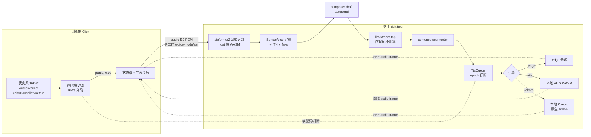

# dsh-voice-mode

[](LICENSE)
[](https://github.com/qishuilalala/dsh-voice-mode/releases)
[](https://www.npmjs.com/package/dsh-voice-mode)
[](https://github.com/qishuilalala/dsh-voice-mode/actions/workflows/ci.yml)

DeepSeek Harness 语音双工对话模式：会话内一键进入 → 边说边出字的流式识别 → 停顿自动发送 → 最终答复按句合成后播放 + 实时字幕，开口即可打断（真 barge-in）。默认语音路径无需额外语音 API Key，识别在宿主端推理；宿主 LLM 的配置与费用另计。

**中文** · [English](https://github.com/qishuilalala/dsh-voice-mode/blob/HEAD/plugin/dsh-voice-mode/README.en.md)

> **Full-duplex voice mode for DeepSeek Harness** — streamed ASR to an editable draft, sentence-by-sentence read-aloud with live captions, and speaking interrupts playback and the running turn.


### 麦克风按钮即状态面板（PR #16，[@dyguests](https://github.com/dyguests) 贡献）


dsh ≥0.1.7 上按钮挂在发送键左侧（`conversation.input.activity`），更早的版本仍在输入框右侧。状态全部画在按钮上：

- **聆听**：绿色三根竖条，随麦克风音量跳动；**朗读中**：蓝色五根竖条，随播放音量跳动；**按住说话**：红色
- **说完就关**（`mode: once`）：发出后关麦、转圈等回复，读完显示对勾并自动退出
- **检测到说话**：右上角橙点；**出错**：左上角红点（悬停看原因）
- **点击**：平时进入/退出；不在语音模式但正在朗读（`readAloud: always`）时点一下 = 停止朗读；等待回复或朗读期间单击 = 停止朗读并完全退出。点按钮不会抢走输入框的光标
- **右键菜单**（鼠标右键或键盘菜单键；触屏长按仍是按住说话）：交互模式、朗读回复范围、字幕浮层、状态条、自动发送
- 状态条与字幕默认开启；两项都关掉即上图的「全部收进按钮」形态，此时录音计时显示在按钮下方、提示文字显示在按钮旁


> **当前状态（2026-10-28）**：npm 已发布 v0.7.33；v0.7.32 扩展宿主验证矩阵，v0.7.31 修复当时的 Edge 握手故障。**main 未发布修复**：Kokoro int8/fp32 主模型及固定摘要支持文件改用匹配的上游历史版本；npm v0.7.33 不包含这项后续下载修复。请勿关闭摘要校验。
>
> CI 通过不代表真实听感、所有硬件或所有宿主版本均已验证。详见 [CHANGELOG](https://github.com/qishuilalala/dsh-voice-mode/blob/main/CHANGELOG.md)、[兼容证据](https://github.com/qishuilalala/dsh-voice-mode/blob/main/docs/compat-contract.md)和[后续路线图](https://github.com/qishuilalala/dsh-voice-mode/blob/main/docs/plan/roadmap-2026-10.md)。包声明范围为 `>=0.1.1-rc.2 <0.3.0-0`，未测版本不保证。


---

## 🤝 Fork 增强（本仓库新增）

本仓库在上游 [haoku123/dsh-voice](https://github.com/haoku123/dsh-voice) 基础上加入了大量增强，核心如下（完整清单见 git 历史与 [docs/rules/STATE.md](https://github.com/qishuilalala/dsh-voice-mode/blob/main/docs/rules/STATE.md)）：

- **朗读默认 Edge 云端；本地 TTS 可选（隐私优先）**：本地合成不向独立在线 TTS 服务发送回复文本，宿主 LLM 的网络请求不受此选项控制——
  - 本地 VITS（WASM 运行时，`sherpa-onnx-vits-zh-ll`，纯中文，5 说话人）；
  - 本地 Kokoro（**中英混读**，103 音色；`int8` 默认约 109MB / 可选 `fp32` 约 311MB 的较大模型），经 `sherpa-onnx-node` **原生 addon** 运行（原生运行时，实际资源占用与稳定性需按设备验证）；
  - Edge 云端为默认朗读引擎，也可在设置中重新选择（设置 `ttsEngine: edge`）；设置面板「朗读引擎」热切换。
- **Kokoro 音色全量 103 个**（F0 实测标定性别），四个常用男声置顶带编号；音色面板用 **下拉列表 + ◀▶ 步进**切换；
- **增量传输**：partial 只传新增 0.9 秒，长段按住说话松手**秒出定稿**（不再整段重传重解码）；
- **交互增强**：输入框旁**模式切换按钮**（持续聆听 ⇄ 按住说话，保存到设置）；按住说模式下**按住才录、不按住不打断**；
- **长段支持**：持续聆听连续多段自动拼成一条消息（内部按 30s 分块识别，跨块累积拼接），静音断句默认 1500 毫秒；按住说停顿不断句；
- **朗读稳定性**：打断即终止在途合成释放 CPU；合成不阻塞宿主主线程，句间等待取决于模型与硬件；长朗读不触发空闲下线；
- **安全加固**：会话存在性校验 / 回环+Origin 校验 / 按端点配置限流 / 主要模型与清单内支持文件固定 SHA256（辅助目录仍为清单/存在性检查） / 下载域名白名单 / 重定向守卫。

> ℹ️ 顶部 `demo-voice-flow.gif` 是**界面的真实录制示例**（语音模式 → 边说边出字 → 停顿自动发送 → 按句朗读 + 实时字幕），由 `screenshots/scripts/capture-demo.mjs` 驱动真实链路产出；UI 持续演进，以实际界面为准。

---

## ✨ 功能

- **语音模式**：输入框工具排麦克风按钮或全局快捷键 `Ctrl+Shift+V` 进入/退出；光标在输入框里时还可按 `Alt+Enter`（Mac 为 `Option+Enter`）切换（不插入换行）；全局单活（同一时刻仅一个会话处于语音模式，切换会话自动让出）
- **三种交互模式（右键麦克风或设置可切换，切换即持久化）**：
  - `toggle`（默认）持续聆听：RMS VAD 分段 → zipformer2 流式识别（边说边出字，实时字幕预览）→ 静音约 1500 毫秒断句进草稿，连续多段拼成一条消息，再静音约 1.2 秒（合计约 2.7 秒）自动发送；按住 `Ctrl` 强制立即发送
  - `hold` 按住说话：空闲时**直接按住麦克风按钮就开始录音、松手即发**（不必先点一下进入；短按仍是进入/退出）；发出后等回复结束（开朗读则读完）自动退出语音模式；关闭自动发送时松手只把文字留在输入框、不发送并直接退出；按住时没说话约 25 秒后兜底退出；滑出取消、`Esc`/失焦放弃本段；按住期间停顿不断句（上限 10 分钟）；`Ctrl` 按住即录、松开即发
  - `once` 说完就关：像 `toggle` 一样说一段，发出后关麦，等回复朗读完自动退出语音模式（关闭自动发送时：说完这一段即退出，文字留在草稿）
- **朗读范围**（`readAloud`）：`voice`（默认）只朗读语音模式下的回复；`always` 当前可见会话的所有回复都朗读（含打字发的；同一会话开多个标签页只在最后看的那个上播）；`off` 从不朗读
- **唤醒词（可选，默认关）**：设置 `wakeWord` 后进入待机态，说出唤醒词才开始识别（如「你好小D」）。**可直接与命令连说**（「你好小D，帮我查天气」）——唤醒词会在定稿/字幕里自动剥掉、不进消息；匹配带容错（同音字替换「小莫→小墨」、首字错、前置语气词「呃/喂/我说」），建议 3-4 字；待机态状态条实时显示「说『x』开始 · 它听到的转写」，唤醒成败可自查。边界（重要）：**仅 `toggle` 模式生效**（`hold` / 手动打断下唤醒词静默失效）；**说完整一句后回到待机态需重说唤醒词**（只喊唤醒词、还没说命令时保持聆听，可停顿想好再说）；**朗读期说唤醒词不触发**（打断由 VAD 开口即触发，与唤醒词无关）
- **字幕档位**：`captionFontSize` 4 档（0=12px / 1=14px / 2=18px / 3=24px）+ `captionMaxWidth` 3 档（0=50vw / 1=70vw / 2=90vw），窄屏自适应
- **让位语义**（ADR-0008）：`backchannelYield` 默认开—— 朗读期用户插话「嗯/对」自动让位 1.5s，真要说走硬打断；让 LLM 主动让出话轮（人格层让位）；关掉恢复改造前行为
- **输出链路**：只朗读最终答复的 `text-delta`（reasoning/工具调用不读），按句合成后播放（默认 Edge 云端；可切本地 VITS/Kokoro，中英混读选 Kokoro）+ 右下角实时字幕浮层；工具调用触发提示音；全文照常写入聊天记录；口语化提示词（设置 `spokenFormat`，默认开）让回复为自然短句、不带 Markdown 排版符号
- **开口打断（barge-in）**：服务端 Silero VAD 帧级检测 + 回声门控（echoGateDb）三档灵敏度 → 本地静音 + host 合成队列作废 + 正在运行的回合取消（保留半截并自然续入新消息）；朗读中自动切超灵敏档。开启唤醒词后打断**仍是开口即打断**（打断门控是 VAD，不是唤醒词；打断后回待机态）
- **模型懒加载与进度**：首次使用自动下载识别/合成模型（`.part` 断点续传），状态条实时显示进度；可用 `npm run prefetch` 预下载
- **设置**：入口随 dsh 版本而不同（见下方「设置」），可调朗读引擎/音色/语速/打断灵敏度/静音停顿/空闲超时/模型镜像/自动发送/交互模式/唤醒词/口语化提示词/字幕档位/让位语义/让位窗口/打断语音抢救/LLM 纠错；**音色可试听**（按当前音色+语速即时合成预览，自定义 ShortName 亦可）
- **界面语言**：跟随 dsh 的语言设置（设置 → 通用 → 语言），**切换即时生效、无需刷新**——设置页、语音状态条、字幕、音色名称/性别/口音、错误提示全部随之变化；LLM 口语化提示词也按界面语言选中/英文版。插件词典注册在 dsh 官方 locale 服务的 `voice-mode` 命名空间，社区语言包可据此补充其它语言，缺失的语言回落英文。插件名称与描述在「插件」页同样按语言显示。
- **容错与诊断**：麦克风被拒红点提示、模型下载失败可见提示、TTS 连接失败状态条提示（自动退避重试）、提交失败文字留在草稿、SSE 断线自动重连；识别/打断检测通道连续失败、状态同步断连时状态条给出提示（可自愈的瞬时失败不打扰）；SenseVoice 定稿超过 2 秒时状态条显示「识别中… Ns」递增（看得见它在工作）；「复制诊断」一键复制版本/运行状态/设置快照/阶段耗时——**不含任何转写原文**（隐私口径）
- **空闲退出**：5 分钟无活动自动退出并释放麦克风。朗读、AI 说话、回合运行均计为活动，后台标签页同样续期；但距最后一次真实操作（说话 / 打断 / 进入语音）满 2 小时仍会退出

---

## 🚀 快速开始（Quick Start）

```sh
dsh plugin --profile web add dsh-voice-mode
```

命令针对 web profile；其他 profile 使用实际配置名称。安装后按部署方式重启宿主；只有配置了对应 systemd 服务的环境才使用服务重启命令。

**第一次用**：

1. 进入任一会话，按 `Ctrl+Shift+V`（或点输入区麦克风按钮）进入语音模式，状态条显示「聆听中…」；
2. 说一句完整的话（如「帮我看看今天的天气」）→ 实时字幕立即出现，停顿后自动发送；
3. AI 回复开始朗读时，尝试发声打断，检查朗读是否停止及后续转写；设备上不可靠时使用按住说话。

---

## ⌨️ 操作手势

| 手势 | 作用 |
| --- | --- |
| `Ctrl+Shift+V` | 进入 / 退出语音模式（应用内） |
| 输入框内 `Alt+Enter`（Mac 为 `Option+Enter`） | 光标在输入框里时进入 / 退出语音模式，不插入换行；长按不重复切换；设置卡片自己的输入框不拦截；`Cmd/Ctrl+Enter` 不占用（宿主用来发送） |
| 直接说话 | `toggle`：边说边出字，停顿约 1500 毫秒断句进草稿、再静音约 1.2 秒（合计约 2.7 秒）自动发送；按住 `Ctrl` 强制立即发送 |
| 按住麦克风按钮 | `hold`：空闲时直接按住即开始录音，松手发送并在回复结束后自动退出；短按仍是进入 / 退出；滑出 / `Esc` / 失焦放弃本段；右键只开快捷菜单 |
| 点输入框旁模式按钮 | 在「持续聆听 ⇄ 按住说」间切换（保存到设置） |
| 说唤醒词 | 待机态激活识别（配置后） |
| AI 朗读时开口说话 | 打断朗读并取消当前回合 |
| 点状态条「退出」 | 退出语音模式 |
| 点字幕浮层「跳过」 | 跳过当前句朗读 |

---

## ⚙️ 设置

**所有 dsh 版本通用入口：设置（Settings）→ 语音模式（Voice Mode）**。另有按版本不同的次要入口（卡片内容一致）：

- dsh ≤ 0.1.5：设置 → Plugins → 插件配置 → 语音模式
- dsh 0.1.6-alpha 及以后（含 0.1.7、0.2.0）：左侧 **Plugins** → 已安装的 `dsh-voice-mode` → 详情页「语音模式」卡片
- dsh 0.1.7+ 起，设置保存在插件自有文件 `~/.dsh/voice-mode.settings.json`（`$DSH_HOME` 下），优先于 profile 配置里的同名键；首次运行会从旧 `settings.yaml(.imported)` 的 `voice-mode:` 段迁移一次；恢复默认请把该文件内容改成 `{}`（不要删除）。


| 键 | 默认 | 说明 |
| --- | --- | --- |
| `ttsEngine` | `edge` | 朗读引擎：`edge` 微软云端（默认，快）/ `vits` 本地中文 / `kokoro` 本地中英；**即时生效** |
| `kokoroModel` | `int8` | Kokoro 模型精度：`int8`（默认，109MB，纯 CPU/低带宽推荐）/ `fp32`（311MB，音质更好，独显/大内存推荐）；两档共用 103 音色，**即时生效** |
| `voice` | 按引擎 | 音色：VITS 五说话人；Kokoro 103 个（下拉+◀▶，62 深沉/68 浑厚/75 清亮/76 磁性置顶）；Edge 进入时自动加载全量 322 个。行内「试听」可即时预览 |
| `rate` | `1.1` | 朗读语速倍率（0.5 慢速 ～ 2.0 快速），**即时生效** |
| `interruptLevel` | `0` | 发声打断灵敏度（服务端 VAD 帧级检测 + 回声门控）：0 高门槛（3 帧）/ 1 中（2 帧）/ 2 低（1 帧） |
| `bargeInMode` | `detect` | 打断方式：`detect` 自动探测本机原生回声消除状态（默认；未生效时切为长按打断）/ `auto` 强制开口即打断（耳机、安静环境推荐）/ `manual` 长按打断（外放推荐）。批 7O 默认，I10 豁免（ADR-0006） |
| `echoGateDb` | `6` | 无原生 AEC 时的回声门兜底阈值；原生 AEC 有效时不参与。仅在兜底路径中，增大更保守、减小更易触发；先确认设备与打断模式 |
| `silenceMs` | `1500` | 说完整一句的静音停顿毫秒数 |
| `idleTimeoutMinutes` | `5` | 无活动自动退出语音模式的分钟数（朗读计为活动） |
| `modelHost` | 默认源 | 模型下载源（国内网络填 `https://hf-mirror.com`） |
| `autoSend` | `true` | 静音到点自动发送（连续多段拼成一条消息）；关闭则只进草稿（按住 `Ctrl` / hold 松手仍会发送） |
| `autoResume` | `false` | 切回上次语音会话时自动恢复语音模式（默认关）。开启后：下次进入语音会话即自动进入语音模式 + 恢复上次会话；关闭则需手动按 `Ctrl+Shift+V` 重新进入 |
| `mode` | `toggle` | 交互模式：`toggle` 持续聆听 + 1500ms 静音断句；`hold` 按住说话、松手发送（短按退出）；`once` 说一段、回复读完自动退出 |
| `readAloud` | `voice` | 朗读范围：`voice` 仅语音模式下的回复；`always` 当前可见会话的所有回复（含打字发送）；`off` 从不朗读 |
| `showStatusBar` | `true` | 输入框上方的语音状态条；关闭后状态只显示在麦克风按钮上（计时在按钮下方、提示在按钮旁） |
| `showCaptions` | `true` | 朗读时的字幕浮层 |
| `shortcut` | `Ctrl+Shift+V` | 进入 / 退出语音模式的快捷键（修饰键 Ctrl/Shift/Alt/Meta + 一个字母 / 数字 / Enter / Space / Tab）；设置页「快捷键」分组里可点「录制」直接按组合键录入（`Esc` 取消、`Backspace` 清空，缺修饰键或方向键 / F 键等不支持的键会提示）；**留空 = 禁用快捷键**，改用麦克风按钮；**即时生效** |
| `composerShortcut` | `Alt+Enter` | 光标在输入框里时切换语音模式的快捷键（Mac 上即 Option+Enter），不插入换行；格式与录制方式同 `shortcut`；**留空 = 禁用**；设置卡片自己的输入框不拦截；`Cmd/Ctrl+Enter` 不占用；**即时生效**。「恢复默认」把两项快捷键恢复为 `Ctrl+Shift+V` 与 `Alt+Enter` |
| `wakeWord` | 空（关） | 唤醒词（如「你好小D」）：进入后先说唤醒词激活，避免误触；空 = 关闭。**可与命令连说**，词头自动剥掉不进消息；匹配带容错（编辑距离 ≤1 + 前 3 字符前导窗口，吸收同音字/语气词）；**建议 3-4 字**——单字词无容错、2 字词的容错会连带吸收所有同首字的 2 字词（如「小莫」也会唤醒「小张」），介意误唤醒用 3 字以上；每句断句或打断后回待机需重说；**仅 toggle 模式生效**（hold / 手动打断下不生效）；朗读期说唤醒词不触发 |
| `toolBeep` | `false` | 工具调用提示音（默认关）：开启后 AI 调用工具时「滴」一声；关闭则全程静默 |
| `spokenFormat` | `true` | 语音会话注入口语化提示词：开启后**仅当前语音会话**的回复被注入「口语化短句、不用 Markdown 排版符号」提示词（朗读更顺），**即时生效** |
| `senseITN` | `true` | SenseVoice 逆文本归一化（数字/日期/货币规范化；默认开） |
| `senseVoice` | `true` | 定稿是否用 SenseVoice 重译（带标点 + 数字归一化，更准；默认开）。**关闭可省 ~228MB 模型**，只走流式识别（更快、精度下降） |
| `captionFontSize` | `0` | 字幕字号档位 0=12px / 1=14px / 2=18px / 3=24px（默认 0 与现状字节等价） |
| `captionMaxWidth` | `1` | 字幕宽度档位 0=50vw / 1=70vw / 2=90vw（视口 <686px 窄于 480px，≈686px 接近 480px，>686px 宽于 480px） |
| `backchannelYield` | `true` | 让位语义（ADR-0008）；朗读期说「嗯/对」自动让位 1.5s + 真要说走硬打断；关 = 行为等同改造前 |
| `bargeInSalvage` | `true` | 打断语音抢救（Issue #15 批 1 / ADR-0012）：AI 朗读时你开口打断，自动保留从开口到打断生效之间你说的话，并入识别继续发送（修「打断吃句」；关 = 丢弃打断前语音——仅外放且无回声消除的环境建议关） |
| `llmCorrect` | `false` | LLM 纠错（Issue #15 批 4，默认关）：发送前用大模型对整条语音文本做一次纠错（只改错别字/同音字/标点，保持原意；复用宿主已配置模型。开 = 每条消息多一次约 1 秒的纠错等待；纠错失败自动用原文；模型改成回答你而非纠错时同样回退原文） |
| `yieldMs` | `1500` | 让位窗口时长（ms，500-3000）：`backchannelYield` 命中后 TTS 丢帧持续时长；窗口内用户真要说则由原 `hardBreak` 接管，窗口到点自动恢复播放 |

生效时机分四档：① 即时——快捷键 / 输入框快捷键 / 交互模式 / 朗读范围 / 自动发送 / 字幕浮层 / 状态条 / 朗读引擎 / 音色 / 语速 / 口语化提示词（对后续回复生效）/ 模型镜像（下次下载尝试即生效）；② 下次识别时——定稿重译（SenseVoice）/ 逆文本归一化；③ 下一段话——静音判定时长（断句端点；发送等待固定 1.2 秒不受影响）；④ 下次进入语音模式——打断灵敏度 / 打断方式 / 回声门控 / 自动恢复 / 唤醒词 / 工具提示音 / 字幕字号 / 字幕宽度 / 短应答让位 / 让位窗口 / 打断语音抢救 / LLM 纠错 / 空闲时长。已保存但未生效的项会列在设置卡片顶部（含当前生效值）。设置项默认值由插件配置（`base` 层）提供。

### 本地音色（VITS / Kokoro）

> **桌面端（Electron）提示**：官方桌面端的宿主运行在 Electron 里，其 V8 不允许 Kokoro 的原生 addon 返回外部缓冲区。插件会自动改用一个真正的 Node.js 来跑 Kokoro——**需要系统 PATH 上有 Node.js ≥18**（或用环境变量 `DSHVM_NODE` 指定路径）；没有则 Kokoro 会提示失败，请改用默认的 Edge 或本地 VITS（两者在桌面端不受影响）。

- **VITS（纯中文）**：`suyingxue` 素映雪·女 / `gunian` 顾念·男 / `fushiyu` 傅斯遇·女 / `bingjiao` 冰娇·男 / `bazong` 霸总·男
- **Kokoro（中英混读均可）**：103 个音色全量入表，面板按编号 + 实测性别标注；四个常用男声置顶：`62` 深沉 / `68` 浑厚 / `75` 清亮 / `76` 磁性；中文女声 `48` 小北 / `49` 小妮 / `50` 小小 / `51` 小艺。音色只是风格向量，**语言能力与音色无关**。

### 常用 Edge 音色（完整清单见 `node scripts/list-voices.mjs`）

| ShortName | 说明 |
| --- | --- |
| `zh-CN-XiaoxiaoNeural` | 晓晓 · 女声（默认） |
| `zh-CN-XiaoyiNeural` | 晓伊 · 女声 |
| `zh-CN-YunxiNeural` | 云希 · 男声 |
| `zh-CN-YunjianNeural` | 云健 · 男声 |
| `zh-CN-YunyangNeural` | 云扬 · 男声 |
| `zh-CN-YunxiaNeural` | 云夏 · 男声 |
| `zh-CN-liaoning-XiaobeiNeural` | 小北 · 东北话 · 女声 |
| `zh-HK-HiuMaanNeural` | 晓曼 · 粤语 · 女声 |
| `zh-TW-HsiaoYuNeural` | 小雨 · 台湾腔 · 女声 |
| `en-US-AriaNeural` | Aria · English · 女声 |

---

## 🔧 配置（bundle patch / settings.yaml）

也可以直接编辑 `~/.dsh/settings.yaml` 的 `voice-mode:` 段（设置面板与 RPC 写的是同一份文档层）：

```yaml
- id: voice-mode
  name: dsh-voice-mode
  config:
    enabled: true                 # false = 完全禁用语音模式（toggle 会被拒）
    cacheDir: ~/.cache/dsh-voice-mode/models   # 可覆盖；否则用平台默认
    # 以下为设置项播种的默认值（设置面板优先级更高，面板是权威源）：
    voice: zh-CN-XiaoxiaoNeural
    rate: 1.1
    interruptLevel: 0
    silenceMs: 1500
    idleTimeoutMinutes: 5
    modelHost: https://huggingface.co
```

> 注意：`voice` / `rate` / `interruptLevel` / `silenceMs` / `idleTimeoutMinutes` / `modelHost` / `autoSend`
> 的**生效值来自设置面板**；bundle 配置只负责为这些键播种默认值
> （`enabled` / `cacheDir` 则仅由 bundle 配置决定）。
> 插件 HTTP 命名空间固定为 `/voice-mode`（与客户端打包契约一致，不可配置）。

---

## 🌐 API

| 路由 | 说明 |
| --- | --- |
| `GET /voice-mode/stream` | SSE：`event: audio`（`{sessionId, seq, text, audio(base64 MP3)}`）、`event: mode`（全局单活归属）、`event: tool`（提示音）、`event: asr-progress / asr-ready / asr-error / tts-error` |
| `POST /voice-mode/toggle` | `{sessionId, on}` 进入 / 退出语音模式（全局单活） |
| `POST /voice-mode/asr` | 裸 f32 LE 16k PCM → `{text}`（流式 zipformer2）；模型未就绪返回 `202 {loading}`；`?reset=1` 丢弃在途段（唤醒词命中时使用） |
| `POST /voice-mode/cancel` | `{sessionId}` 作废 TTS 队列并丢弃在途 ASR 段 |
| `POST /voice-mode/preview` | `{voice, rate?}` 一次性合成试听 → `audio/mpeg`（400 缺 voice / voice 过长；502 合成失败，如无效 ShortName；403 插件 `enabled=false`）。不要求语音模式处于激活态；使用独立合成连接，不影响朗读队列 |
| `GET /voice-mode/config` | 客户端启动参数（静音阈值 / 灵敏度 / 音色与语速等）——含 ASR 侧字段 `senseITN` / `senseVoice` / `captionFontSize` / `captionMaxWidth` / `backchannelYield` / `yieldMs` / `bargeInSalvage` / `llmCorrect` |
| `POST /voice-mode/correct` | `{text}` 发送前 LLM 纠错（只改错别字/同音字/标点；复用宿主已配置模型）→ `{text}`；失败/超时/无模型回退原文，不阻断发送 |
| `GET /voice-mode/voices` | Edge 全量音色清单（设置面板选 Edge 时拉取；网络失败由客户端回退常用清单） |
| `GET /voice-mode` | 健康检查 `{ok, name, enabled, active}` |

---

## 💾 模型与缓存

- 识别模型：`csukuangfj/sherpa-onnx-streaming-zipformer-zh-int8-2025-06-30`（encoder ≈154 MB / decoder / joiner / tokens，合计约 160 MB），宿主端经 sherpa-onnx（Node WASM，Apache-2.0，原生跨平台）运行
- 缓存目录的平台默认：
  - **Windows**：`%LOCALAPPDATA%\dsh-voice-mode\models`
  - **macOS / Linux**：`~/.cache/dsh-voice-mode/models`
  - 两者都可用 `cacheDir` 覆盖
- 下载用 `.part` 断点续传（仅单文件模型）；`huggingface.co` 失败时回退 `hf-mirror.com`（可用 `modelHost` 配置）
- 下载有 120 秒空闲看门狗：收到字节即重置，上游卡死超时会中止并换源；关闭面板会中止在途下载
- 模型主文件 SHA256 固定；同一进程内文件 size+inode+ctime 未变则不重复校验（缓存只在内存，重启后首次全量校验）；Kokoro 的 espeak-ng-data 目录树按清单文件大小 / 文件数判完整，首次下载完成后可完全离线使用

---

## 🏛️ 工作原理（Architecture）



- 识别在 **host 端本地运行**（zipformer2 中文 int8 WASM + SenseVoice 定稿，模型懒下载），音频不上传第三方；识别定稿由 SenseVoice 补标点；
- 朗读默认 **Edge 云端**；本地 VITS 纯中文 / Kokoro 原生中英（跑在独立子进程、崩溃自愈）可选（隐私优先）；
- 同一时间仅一个会话处于语音模式（全局单活）；LLM 流被无损观察（不阻塞）。

详细架构决策：见 [`docs/adr/`](https://github.com/qishuilalala/dsh-voice-mode/blob/main/docs/adr/README.md) 12 个 ADR。

---

## 🔍 与早期上游实现的历史对照

| 维度 | 早期上游（历史） | dsh-voice-mode（本插件） |
| --- | --- | --- |
| 识别模型 | 云端 API（需 key） | **本地 zipformer2 + SenseVoice**（零 key） |
| 多语种 | 英文为主 | **SenseVoice 自动识别（zh/en/ja/ko/yue）+ ITN** |
| 朗读引擎 | 云端 TTS | **Edge 云端 + 本地 VITS/Kokoro** 三选一 |
| 打断检测 | 基础 VAD | **三档灵敏度 + 回声门控 + 让位语义** |
| 字幕 a11y | 无 | **4 档字号 + 3 档宽度 + 主题跟随** |
| 唤醒词 | 无 | **轻量流式匹配 + 前缀语气词白名单** |
| 兼容 dsh | — | 声明范围 `>=0.1.1-rc.2 <0.3.0-0`；以已测版本矩阵为准 |

---

## 🔐 权限与数据流声明

插件如实声明它会做的事（与 awesome-dsh-plugin 的能力扫描 `network / fs-read / fs-write / shell / env` 一一对应）：

| 类别 | 具体行为 | 数据去向 |
| --- | --- | --- |
| **network** | Edge 将待朗读文本发往微软在线服务；本地模型从官方源或配置镜像下载，主要模型及清单内支持文件做摘要校验，辅助目录用清单/存在性检查；插件在宿主注册 `/voice-mode/*` 路由 | 浏览器音频发送到所连接的 dsh 宿主识别，不使用独立云 ASR；提交文本及可选 LLM 纠错遵循宿主配置。切换本地 TTS 不会让宿主 LLM 自动离线 |
| **fs-read / fs-write** | 模型缓存（Linux/macOS `~/.cache/dsh-voice-mode/models/`，Windows `%LOCALAPPDATA%\dsh-voice-mode\models\`）；dsh 0.1.7+ 的设置覆盖层 `$DSH_HOME/voice-mode.settings.json`；**不读写你的工作区文件** | 全部在本机 |
| **shell（子进程）** | 本地 TTS 合成跑在独立子进程（`child_process.fork` → `lib/tts-vits-worker.cjs`）；宿主为 Electron（官方桌面端）时，为 Kokoro 额外探测并启动一个真正的 Node.js（`node -p …` 探测版本，见 ADR/兼容契约）。**不执行用户输入、不经 shell 拼接命令** | 本机 |
| **env** | 使用目录和运行时定位相关环境设置，如 `DSH_HOME`、`LOCALAPPDATA`、`PATH` 和可选 `DSHVM_NODE`；默认语音路径无需额外语音服务密钥 | 宿主 LLM 的配置和费用另计 |

补充：调试用的真机录制（fixture）默认**关闭**；插件不上传遥测。完整威胁模型与漏洞报告方式见仓库根目录 [`SECURITY.md`](https://github.com/qishuilalala/dsh-voice-mode/blob/main/SECURITY.md)。

### 第三方模型与服务说明

- **本地模型不随包分发**：ASR（zipformer 流式、SenseVoice 重译）、VAD、本地 TTS（VITS / Kokoro）的模型由插件**首次使用时从 Hugging Face（或你配置的镜像）下载**到本机缓存，来源为 [sherpa-onnx](https://github.com/k2-fsa/sherpa-onnx) 生态的导出仓库（`csukuangfj/*`）。各模型的许可由其**原作者**决定，本插件的 MIT 许可**不覆盖**这些模型；用于商业场景前请自行核对上游许可（模型清单见下文「模型与缓存」，对应常量在 `src/asr-host.ts` / `src/tts-local.ts`）。
- **Edge 云端朗读是第三方在线服务**：默认引擎经 [`msedge-tts`](https://github.com/Migushthe2nd/MsEdgeTTS) 使用微软 Edge 浏览器「大声朗读」的在线接口——这不是微软官方提供的稳定 API，**可用性、速率与条款均由微软决定**，可能随时变化。对稳定性/合规有要求的场景请改用本地 VITS / Kokoro（离线）。
- 被内联进发布包的第三方代码（`msedge-tts` 及其依赖）的许可见 [`THIRD_PARTY_NOTICES.md`](./THIRD_PARTY_NOTICES.md)；`pnpm audit` 检查依赖数据库中的 high+ 公告，不能保证不存在未公开或未覆盖漏洞（CI `audit` job 持续监测）。

### 兼容声明（插件市场的版本筛选依据）

`package.json` 声明 `engines.dsh = ">=0.1.1-rc.2 <0.3.0-0"`。这是版本准入范围，不代表区间内每个版本都已实测。兼容记录列出了截至 0.2.2-alpha.2 的已测版本及实际测试形态。每周工作流只比对上游标签并为未覆盖版本开 issue，不会自动跑完整矩阵。`peerDependencies` 声明宿主提供的 `@deepseek-ai/cordis` 与 `react`。

## 🚧 已知限制

- **云端朗读（Edge）依赖微软在线服务**：服务端可能随时调整握手/限流（2026-10-15 即发生过，见 CHANGELOG 0.7.24）；若连续多句朗读失败，状态条/弹出提示会建议切换本地 VITS / Kokoro，设置面板可一键切换
- 发声打断依赖浏览器回声消除（`echoCancellation`）；扬声器音量过大时可能漏声到麦克风
- `Ctrl+Shift+V` 会覆盖浏览器「粘贴纯文本」快捷键（普通粘贴仍可用 `Ctrl+V`）
- 识别质量受环境噪声影响；zipformer2 中文流式 + SenseVoice 多语（中英日韩粤）定稿
- 浏览器自动播放策略：朗读需要页面已有用户交互（点击麦克风即满足）；进入 / 退出、设置读写、「试听」均依赖 `AbortSignal.timeout`（Safari 16+ / Chrome 103+ / Firefox 100+；老浏览器上这些操作会立即提示失败，属预期降级）
- **唤醒词为轻量实现**（流式文本匹配，非专用 KWS 引擎）：嘈杂环境可能延迟或误激活；唤醒词本身不会进入聊天
- hold 模式按住时切换窗口/标签页会**放弃本段**（防持续收音）
- hero（新会话空态）无语音入口：请先进入会话使用麦克风按钮
- `spokenFormat` 提示词经官方 `system-prompt/assemble` 瀑布注入；若当前会话使用**完整提示词**配置（persona `complete: true` 的 agent preset），提示词不注入（官方 complete 契约优先）
- 本地 Kokoro 打断后下一句前可能需要重建引擎，耗时取决于设备与模型（打断即终止在途合成的代价）
- **苹果 Safari / iOS**：
  - 需 **HTTPS 或 localhost**（iOS/macOS Safari 强制安全上下文；`http://` 局域网 IP 下麦克风不可用）
  - 首次进入需授权麦克风；被拒后到「设置 → Safari → 麦克风」开启（iOS）
  - iOS 后台/锁屏时识别与朗读暂停，回前台自动恢复（可能丢句）；建议语音模式期间保持前台
- **安全说明**：插件 HTTP 面（`/voice-mode/*`）遵循宿主安全模型——请勿将 dsh 端口直接暴露公网；经反向代理发布时由代理层（如 basic auth）鉴权；插件侧对敏感操作保留会话归属校验

---

## 🛠️ 故障排查

| 现象 | 处理 |
| --- | --- |
| 点麦克风无反应，状态条红字 | 浏览器拒绝麦克风：地址栏（iOS 为 设置 → Safari → 麦克风）开启后重试 |
| 状态条「正在加载模型… x%」卡住 | 检查网络；模型较大可先 `npm run prefetch`；国内网络 `modelHost` 配 `https://hf-mirror.com` |
| 朗读无声音/无字幕 | Edge 需要外网；核对状态条、页面音量与自动播放权限。模型就绪后可手动切本地引擎；首次下载失败先看顶部 Kokoro 未发布修复说明，不绕过摘要校验。历史 Edge 握手修复见 CHANGELOG |
| AI 回复**偶尔不朗读**（某句没声/整条没声） | 已定位三类原因并修（v0.7.10）：① 云端 TTS 偶发超时——单句自动重试 3 次，仍失败会**跳过该句并在状态条提示**「有一句朗读失败，已跳过」（此前是静默丢句）；② 浏览器挂起 AudioContext（切到后台标签页/长时间静音后回来）——播放被调度但无声、UI 却显示朗读中；现在每次入队与**任意点击/按键**都会自动恢复；③ SSE 断线丢帧导致整句不完整——按设计丢弃该句（避免播坏音频），可开 `localStorage['dsh-voice-mode.telemetry']='1'` 看 `tts-drop-sentence` 诊断 |
| 语音模式进不去 | 检查插件 `enabled`；多标签页时确认当前会话为活动会话 |
| 识别到但不是我要说的 | 环境噪声或唤醒词误判：减少噪声并对比实时转写和定稿；`interruptLevel` 只影响打断，不提高识别准确率 |
| 唤醒词唤不醒 | 先看待机态状态条的实时转写（它听到了什么）：同音字 1 字内已自动容错；停顿约 1.5 秒（= 静音断句时长）再说，清掉待机段残留语音、从段首重新匹配；换一个转写稳定的词（建议 3-4 字） |
| 打断后说话没反应（开了唤醒词） | 唤醒词只管「开始识别」的门：打断/每句断句后回到待机态，**需重说唤醒词**再继续说；待机态状态条会显示「说『x』开始」提示 |
| 唤醒词完全没反应 | ① 确认交互模式是 `toggle`（`hold` 与手动打断下唤醒词不生效）；② 确认 `bargeInMode`：`manual`（或 `detect` 在本机无原生回声消除时自动落 manual）会关闭常驻聆听 → 唤醒词失效，改回 `auto` 或按住麦克风/Ctrl；③ 朗读期说唤醒词不触发（先等 AI 说完）；④ 看待机态实时转写，确认它听到了什么（同音字 1 字内已容错，建议 3-4 字词） |
| 按住说话松手后没反应 | 确认交互模式为「按住说」且按住期间按钮高亮；松手后识别定稿约 1 秒内进入草稿 |
| 打不断（朗读中开口无反应） | 将 `interruptLevel` 向 2 调整（2 最敏感，0 高门槛），确认麦克风与回声消除；仍不可靠时用按住说话。原生 AEC 有效时 `echoGateDb` 不参与门控，无原生 AEC 时才是兜底参数 |
| 官方桌面端上选本地 Kokoro，设置里显示「加载失败」并提示需要 Node.js | 桌面端宿主是 Electron，Kokoro 的原生 addon 在其中不可用：在系统 PATH 上安装 Node.js ≥18（或设环境变量 `DSHVM_NODE` 指向它）后重试；或改用默认的 Edge / 本地 VITS（桌面端不受影响） |
| 字幕被输入框挡住 | 默认 `captionMaxWidth=1`（70vw）+ `captionFontSize=0`（12px）在窄屏可能与底部输入框重叠；调高档位或点字幕浮层「×」收起 |
| 让位行为异常（朗读期说「嗯」不停 / 真话被打断） | 「嗯/对」类短词触发让位 1.5s 后继续朗读；继续说真话会走硬打断；不要时关 `backchannelYield` 即可恢复改造前行为（ADR-0008） |
| 朗读期说「嗯」没让位 | 确认 `backchannelYield=true`（默认开）；hold 模式松手后让位 1.5s 内继续说话会变硬打断 |
| 空闲 5 分钟自动退出（不想退） | 调高 `idleTimeoutMinutes`（默认 5 分钟；朗读 / AI 说话 / 回合运行均计为活动，后台标签页同样续期；距最后一次真实操作满 2 小时仍会退出） |
| 点麦克风一直转圈 | 宿主不应答时 8 秒超时；转圈时再点一次麦克风即取消进入，不会残留语音会话 |

---

## 🛣️ 路线图（Roadmap）

[当前路线图](https://github.com/qishuilalala/dsh-voice-mode/blob/main/docs/plan/roadmap-2026-10.md)统一记录优先级、候选准入、验收门槛与回滚条件。

1. 先闭环已确认缺陷，验证真实 ASR → 可编辑草稿 → 发送 → TTS。
2. 优先解决丢句、误发、编辑冲突和恢复成本等高损失体验问题。
3. 推进可控的模型更新与回退；新模型或协议只有实测瓶颈证据才进入实验，不承诺必增后端。

客户端 VAD、WebSocket 重写、声音克隆与广泛工具控制不作为已批准的近期工作。[历史 backlog](https://github.com/qishuilalala/dsh-voice-mode/blob/main/docs/competitive/backlog.md)保留先前研究，旧 Ready 和估时不构成当前承诺。

---

## 🛠️ 开发

源码开发/测试使用 Node.js 22.18 或以上的 22.x 与 pnpm 11；插件运行时声明不等于测试工具链要求。

```sh
pnpm install && pnpm build    # esbuild：lib/index.js（host）+ lib/client.js（browser）
pnpm test                     # 执行包脚本中的单测、台架与结构守卫；范围以实际配置和输出为准
systemctl restart dsh         # 本机加载新 host 代码；其他平台重启 dsh 进程
```

> 注意：dsh 安装的是 pnpm `file:` 链接（目录拷贝），改完 `node build.mjs` 后需把 `lib/client.js` 同步到 `<profile>/node_modules/dsh-voice-mode/lib/` 再刷新页面（`lib/index.js` 与工作区为同一文件自动同步）。集成探测脚本（`test/hold-e2e.js`、`test/spoken-prompt-rpc.sh`、`test/spoken-toggle-ui-check.js`）位于仓库根 `test/`，不在 npm 包内。

```
src/index.ts         host：单活指针、llm/stream tap、SSE、settings 注册、口语化提示词注入
src/asr-host.ts      host：zipformer2 流式识别 + SenseVoice 定稿 + 模型懒下载（.part 断点续传）+ 增量喂料
src/models.ts        host：模型下载/校验（SHA256 固定 + 域名白名单）
src/security.ts      host：限流器与安全守卫
src/tts-local.ts     host：本地 TTS 引擎（VITS WASM / Kokoro 原生 addon，子进程管理）
src/tts-vits-worker.ts 子进程：合成执行（base64 IPC，空文本静音守卫）
src/tts-queue.ts     host：逐会话 TTS 队列 + epoch 打断 + 连续失败计数（云端整体不可用时给出可行动提示）
src/tts-runtime.ts   host：Electron 宿主下 Kokoro 子进程的真 Node 选择
src/settings-store.ts / settings-http-scope.ts  host：≥0.1.7 设置自持久化（覆盖层文件 + 端点，ADR-0009）
src/segmenter.ts     host：句子切分 + 文本消毒（markdown 剥离 + 噪声字符剔除）
src/asr.ts           client：音频采集、VAD 分段、增量识别、唤醒词、按住说门控
src/client.tsx       client：麦克风按钮 + 模式切换按钮 + 状态条 + 字幕浮层 + 打断
src/strings.ts       client：中英文案词典（zh / en 两份，键一一对应；有测试守卫）
src/i18n.ts          client：接入官方 locale 服务（语言即时切换、语言包扩展、无服务时回退）
src/voice-catalog.ts host+client：音色目录单一数据源；src/voice-labels.ts 按语言生成音色/镜像标签
src/errors.ts        host↔client：稳定错误码（host 不发自然语言，客户端按语言翻译）
src/prompts.ts       host：LLM 口语化提示词（中/英）与试听例句（按音色语种）
```

---

## 📄 License

[MIT](./LICENSE)

> 部分实现借鉴 [haoku123/dsh-voice](https://github.com/haoku123/dsh-voice)（派生声明见子包 LICENSE）。