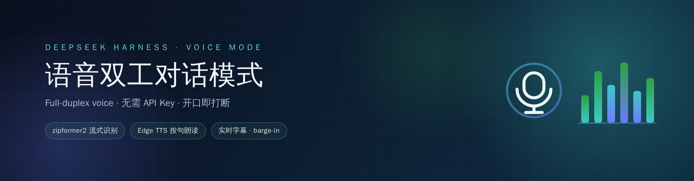
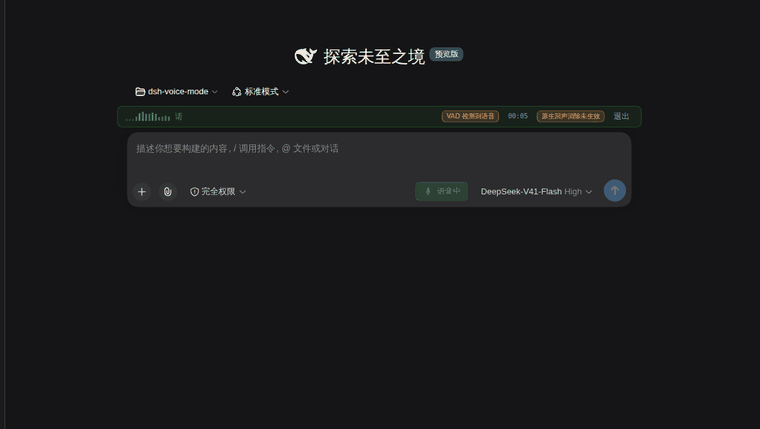
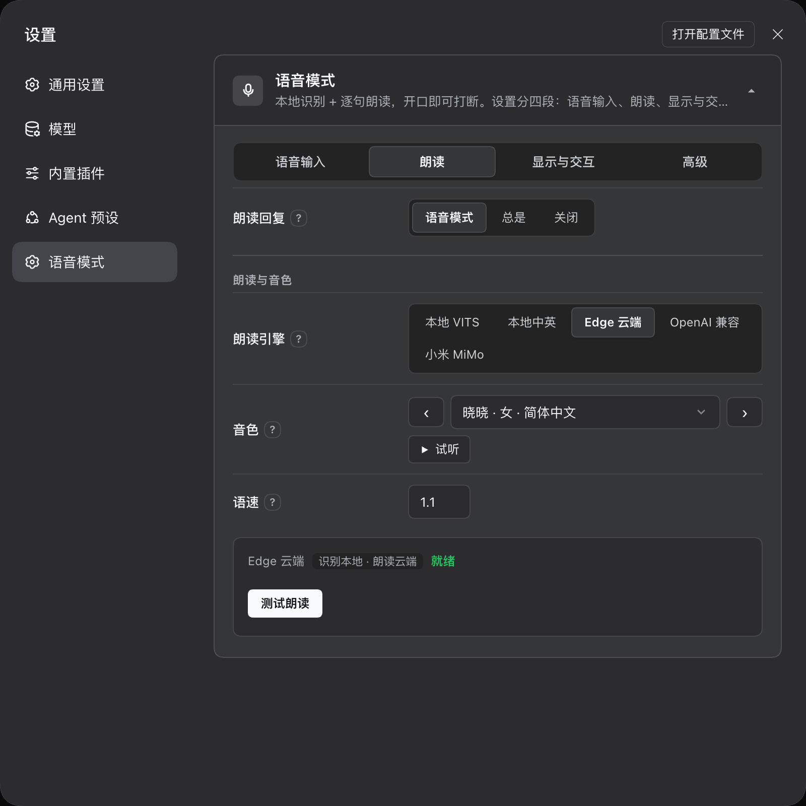
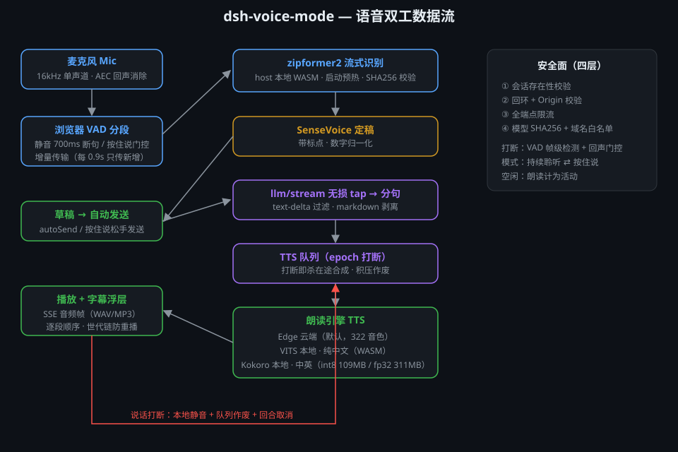

# dsh-voice-mode

[](https://www.npmjs.com/package/dsh-voice-mode)
[](https://www.npmjs.com/package/dsh-voice-mode)
[](https://github.com/qishuilalala/dsh-voice-mode/actions/workflows/hol-scanner.yml)
[](https://github.com/qishuilalala/dsh-voice-mode/actions/workflows/ci.yml)
[](https://github.com/qishuilalala/dsh-voice-mode/blob/main/plugin/dsh-voice-mode/LICENSE)

面向 **DeepSeek Harness（DSH）** 网页端与官方桌面端的全双工语音对话插件：在宿主端本地完成流式语音识别并写入可编辑草稿，模型回复生成时按句合成朗读并配实时字幕，朗读期间开口或按键即可随时打断。默认路径无需额外配置语音识别密钥；宿主对话大模型按原有配置计费与联网。

**简体中文** · [English](https://github.com/qishuilalala/dsh-voice-mode/blob/main/plugin/dsh-voice-mode/README.en.md) · [版本记录](https://github.com/qishuilalala/dsh-voice-mode/blob/main/CHANGELOG.md) · [兼容契约](https://github.com/qishuilalala/dsh-voice-mode/blob/main/docs/compat-contract.md)



---

## 核心功能

- **宿主本地流式语音输入（ASR / STT）**：基于 `sherpa-onnx` 运行 `zipformer2` 流式识别与可选 `SenseVoice` 定稿重译（自动标点与数字/日期规范化），边说边出字、实时回填会话草稿；默认停顿约 1.5 秒断句、再静音约 1.2 秒自动发送，也可关闭自动发送仅作语音听写。
- **三种收音交互模式**：支持「持续聆听（`toggle`）」「按住说话（`hold`，支持直接长按麦克风按钮或键盘 `Ctrl` / macOS `⌃ Control`）」「说完就关（`once`）」；可在设置页、桌面右键菜单或触屏 `⋯` 菜单即时切换。
- **五类逐句朗读引擎（TTS）**：默认使用微软 Edge 在线朗读；支持完全本地离线的中文 VITS 与中英混读 Kokoro（103 音色），也支持接入 7 家内置 OpenAI 兼容在线预设（可按预设独立保存 API Key）、自定义端点与小米 MiMo 语音合成；远程服务超时或异常时可自动回退本地引擎。
- **实时字幕浮层与紧凑模式**：朗读期间在右下角展示 4 档字号、3 档最大宽度的实时字幕（移动端避让底部安全区，播毕支持最近 8 句回看）；关闭状态条与字幕后，全部收音、朗读、计时与告警状态可收拢到输入框旁的单个麦克风按钮上。
- **自然打断与短词让位**：朗读期间开口即可终止当前音频与在途合成队列，并通过 2 秒预录环拼回刚开口的前半句语音（防吞字）；随口回应「嗯 / 对」等短词时自动暂停让位 1.5 秒后继续朗读；外放无回声消除环境下可自动切换或手动指定为按住打断。
- **口语纠错与可选唤醒词**：可在设置面板可视化维护识别纠错词表（修正人名、术语与中英混读听错写法），可选开启发送前大模型轻量纠错与待机唤醒词。




---

## 安装与快速开始

**环境要求**：DeepSeek Harness `>=0.1.1-rc.2 <0.3.0-0`（已实测覆盖 `0.1.1-rc.2` 至 `0.2.3-alpha.2` 的客户端注入锚点、双端类型检查与隔离运行态冒烟），Node.js `>=18.0.0`，支持 `getUserMedia` 与 Web Audio 的现代浏览器（Chrome / Edge / Firefox / Safari 16+）或 DSH 官方桌面客户端。

```sh
# 方式一：从 npm 安装（推荐；按实际环境替换 web 等 profile 名称）
dsh plugin --profile web add dsh-voice-mode

# 未全局安装 dsh CLI 时等价写法：
npx -y @deepseek-ai/dsh plugin --profile web add dsh-voice-mode

# 方式二：源码构建安装（使用 Node.js 22.18+ 的 22.x 版本与 pnpm 11）
git clone https://github.com/qishuilalala/dsh-voice-mode.git
cd dsh-voice-mode/plugin/dsh-voice-mode
pnpm install --frozen-lockfile
pnpm run build
dsh plugin --profile web add .
```

组合包插件安装或升级后需**重启 DSH 宿主进程**生效。首次进入语音模式时会自动按需下载本地识别模型（约 160MB 流式模型 + 可选约 228MB SenseVoice 定稿模型，支持 `.part` 断点续传，状态条实时显示下载进度；中国大陆网络可在设置中将模型镜像填为 `https://hf-mirror.com`，也可提前在包目录执行 `npm run prefetch` 预热缓存）。

---

## 操作手势与快捷键（Windows / Linux 与 macOS 对照）

| 操作场景 | Windows / Linux | macOS | 行为说明 |
| --- | --- | --- | --- |
| 进入 / 退出语音模式 | `Ctrl+Shift+V` | `⌃ Control + ⇧ Shift + V` | 应用内全局切换（注意 macOS 默认使用 `Control` 而非 `⌘ Command`）；可在设置「快捷键」中点「录制」改键或留空停用 |
| 输入框内快速切换 | `Alt+Enter` | `⌥ Option + Return` | 光标在聊天输入框内时切换语音模式，不插入换行，不占用 `Ctrl/⌘ + Enter` 发送键 |
| 持续聆听（`toggle`，默认） | 直接说话；说话中按住 `Ctrl` 立即发 | 直接说话；说话中按住 `⌃ Control` 立即发 | 停顿约 1500ms 断句进草稿、再静音约 1.2s 自动发送；说话时按住 `Ctrl` / `⌃ Control` ≥250ms 松开可立即发送 |
| 按住说话（`hold`）指针/触屏 | 按住麦克风按钮说话，松开发送 | 按住麦克风按钮说话，松开发送 | 未进入语音模式时**直接按住麦克风按钮即可开录**，松手发送并在本轮回复结束后自动退出；按住期间上滑或按 `Esc` 取消 |
| 按住说话（`hold`）键盘 | 进入后长按 `Ctrl`（≥220ms） | 进入后长按 `⌃ Control`（≥220ms） | 已进入语音模式时按住 `Ctrl` / `⌃ Control` 持续收音、松开即发；按 `Esc`、切走窗口或组合按其他键自动放弃本段 |
| 说完就关（`once`） | 说完一句自动停麦，播完自动退出 | 说完一句自动停麦，播完自动退出 | 适合单轮提问；朗读期长按麦克风或按 `Ctrl` / `⌃ Control` 打断后会恢复收音并留在语音模式 |
| 打断或停止朗读 | 开口说话 / 按住 `Ctrl` / `Esc` | 开口说话 / 按住 `⌃ Control` / `Esc` | 自动打断下开口即停；手动打断（`manual`）下朗读期按住麦克风或 `Ctrl` / `⌃ Control` 打断；按一次 `Esc` 停播，连按两次 `Esc` 退出 |
| 快捷菜单 | 右键点击麦克风按钮（或菜单键） | 右键 / 双指点按麦克风按钮 | 触屏端点击麦克风旁 `⋯` 按钮（或空闲非按住态长按 450ms），快速切换交互模式、朗读范围、字幕、状态条与自动发送 |

---

## 设置面板与全部配置项

**所有 dsh 版本通用入口：设置（Settings）→ 语音模式（Voice Mode）**。按宿主版本另有次要入口：

- `dsh <= 0.1.5`：设置 → Plugins → 插件配置 → 语音模式
- `dsh >= 0.1.6-alpha`：左侧 **Plugins** → 已安装的 `dsh-voice-mode` → 详情页「语音模式」卡片（`0.1.7+` 起设置保存在 `$DSH_HOME/voice-mode.settings.json`，权限 `0600`；如需恢复默认，请将文件内容改为 `{}` 而不要直接删除文件）



### 完整设置项说明表（36 项）

| 键 | 默认 | 说明 |
| --- | --- | --- |
| `ttsEngine` | `edge` | 朗读引擎：`edge` 微软在线（默认）/ `vits` 本地中文 / `kokoro` 本地中英混读 / `openai` OpenAI 兼容服务 / `mimo` 小米 MiMo；**即时生效** |
| `kokoroModel` | `int8` | Kokoro 模型精度：`int8`（默认，约 109MB，CPU 推荐）/ `fp32`（约 311MB，高音质）；共用 103 音色；**即时生效** |
| `voice` | 按引擎 | 朗读音色：VITS 5 说话人；Kokoro 103 音色（下拉 + ◀▶ 切换，常用男声 `62/68/75/76` 置顶）；Edge 全量 322 音色；行内「试听」可即时预览；**即时生效** |
| `rate` | `1.1` | 朗读语速倍率（`0.5` 慢速 ～ `2.0` 快速）；**即时生效** |
| `interruptLevel` | `0` | 发声打断灵敏度（服务端 VAD 帧检测 + 回声门控）：`0` 高门槛（3 帧）/ `1` 中（2 帧）/ `2` 低（1 帧） |
| `bargeInMode` | `detect` | 打断方式：`detect` 自动探测原生回声消除（未生效时朗读期自动切为长按打断）/ `auto` 强制开口即打断（耳机推荐）/ `manual` 手动长按麦克风或 `Ctrl` 打断（外放推荐） |
| `echoGateDb` | `6` | 无原生回声消除时的回声门控阈值（`3`–`12` dB）；原生回声消除生效时不参与门控 |
| `silenceMs` | `1500` | 判定一句话说完的静音停顿毫秒数（`500`–`30000`） |
| `idleTimeoutMinutes` | `5` | 无活动自动退出语音模式的分钟数（`1`–`120`；朗读与回合运行计为活动，硬上限 2 小时） |
| `modelHost` | 空（官方源） | 模型下载源覆盖（中国大陆网络可填 `https://hf-mirror.com`）；下次下载即生效 |
| `autoSend` | `true` | 静音到点自动发送（连续多段拼为一条）；关闭后只写入输入框草稿（按住 `Ctrl` 或 `hold` 松手仍发送）；**即时生效** |
| `autoResume` | `false` | 切换回上次语音会话时自动恢复进入语音模式（默认关） |
| `mode` | `toggle` | 交互模式：`toggle` 持续聆听 / `hold` 按住说话、松开发送 / `once` 说完一句、回复播完自动退出；**即时生效** |
| `readAloud` | `voice` | 朗读范围：`voice` 仅语音模式下的回复 / `always` 当前可见会话的所有回复（含打字发送）/ `off` 不朗读；**即时生效** |
| `showStatusBar` | `true` | 输入框上方的语音状态条开关；关闭后状态收拢到麦克风按钮旁；**即时生效** |
| `showCaptions` | `true` | 朗读期间右下角实时字幕浮层开关；**即时生效** |
| `shortcut` | `Ctrl+Shift+V` | 进入 / 退出语音模式的全局快捷键（修饰键 + 字母/数字/Enter/Space/Tab，支持面板「录制」，留空停用）；**即时生效** |
| `composerShortcut` | `Alt+Enter` | 光标在聊天输入框内时的切换快捷键（macOS 为 `Option+Return`，不插入换行，留空停用）；**即时生效** |
| `wakeWord` | 空（关） | 待机唤醒词（如「你好小D」，建议 3–4 字）：仅在 `toggle` 模式空闲待机时生效，可与指令连说并自动剥离词头，每句断句或打断后回到待机 |
| `toolBeep` | `false` | 模型调用工具时是否播放轻提示音（默认关） |
| `spokenFormat` | `true` | 仅为当前活跃语音会话注入「口语化短句、不输出 Markdown 排版符号」提示词；**即时生效** |
| `senseVoice` | `true` | 定稿是否使用 SenseVoice 重译补标点与逆文本归一化（关闭可省约 228MB 模型下载，仅跑流式识别） |
| `senseITN` | `true` | SenseVoice 逆文本归一化开关（将口语数字、日期、金额转为规范书面格式） |
| `openaiPreset` | 空（手动） | 在线 TTS 预设：`siliconflow-cosyvoice2` / `siliconflow-fish` / `openrouter-openai` / `openai-official` / `groq-playai` / `selfhosted-kokoro` / `selfhosted-vllm`（或 `custom` 自定义）；**即时生效** |
| `openaiBaseUrl` | 空（跟随预设/配置） | 在线 TTS 接口地址覆盖（优先级：设置面板 > 内置预设 > 宿主配置文件）；**即时生效** |
| `openaiModel` | 空（跟随预设/配置） | 在线 TTS 模型名覆盖（优先级同上）；**即时生效** |
| `openaiApiKey` | 空（回落配置） | 在线 TTS 全局备用密钥（仅以 `0600` 权限存宿主侧，接口永不回传明文）；**即时生效** |
| `openaiApiKeys` | `{}` | 按预设 ID 独立保存的在线 TTS 密钥表（优先级高于全局密钥，切换预设自动切换对应密钥，接口仅返回布尔状态）；**即时生效** |
| `mimoApiKey` | 空（回落配置） | 小米 MiMo 独立 API Key（走 `api-key` 请求头，与 OpenAI 兼容密钥隔离存储、永不回传明文）；**即时生效** |
| `asrReplacements` | `[]` | 识别后替换词表 `[{from:[听错写法], to:目标写法}]`（上限 200 条 / 12KB，中间结果与定稿均改写，面板显示命中计数）；**即时生效** |
| `captionFontSize` | `0` | 字幕字号档位：`0`=12px / `1`=14px / `2`=18px / `3`=24px |
| `captionMaxWidth` | `1` | 字幕最大宽度档位：`0`=50vw / `1`=70vw / `2`=90vw |
| `backchannelYield` | `true` | 短应答让位：朗读期用户插话「嗯 / 对」自动暂停让位，继续说长句则升级为硬打断 |
| `yieldMs` | `1500` | 短应答让位等待窗口毫秒数（`500`–`3000`），窗口结束未继续说话则恢复朗读 |
| `bargeInSalvage` | `true` | 打断语音抢救：确认打断时将语音起点前 250ms 起的预录音频并入新识别段，防止起音被吞 |
| `llmCorrect` | `false` | 发送前大模型轻量纠错（复用宿主已配置模型修正同音错字与标点，失败或超时自动回退原文） |

**生效时机分四档**：① 即时生效（快捷键、交互模式、朗读范围、自动发送、字幕与状态条开关、朗读引擎/预设/密钥/音色/语速、纠错词表、口语化提示词、模型镜像）② 下次识别生效（SenseVoice 定稿重译、逆文本归一化）③ 下一段话生效（静音停顿阈值）④ 下次进入语音模式生效（其余声学门控、唤醒词、字幕尺寸与空闲超时）。未立即生效的修改会在面板顶部提示其**当前生效值**。

### 本地音色与常用 Edge 音色

> **官方桌面端（Electron）说明**：桌面端宿主的 Electron V8 沙箱限制原生外部缓冲区，插件在运行本地 `kokoro` 时会自动探测并调用系统 `PATH` 上的独立 Node.js（`>=18`，或通过环境变量 `DSHVM_NODE` 指定可执行文件路径）。若本机未安装独立 Node.js，请使用默认的 `edge` 或纯 WASM 的本地 `vits`。

- **本地 VITS（纯中文，5 说话人）**：`suyingxue`（素映雪·女）、`gunian`（顾念·男）、`fushiyu`（傅斯遇·女）、`bingjiao`（冰娇·男）、`bazong`（霸总·男）
- **本地 Kokoro（中英混读，103 音色）**：置顶常用男声 `62`（深沉）、`68`（浑厚）、`75`（清亮）、`76`（磁性）；常用中文女声 `48`（小北）、`49`（小妮）、`50`（小小）、`51`（小艺）
- **常用 Edge 音色**（可在包目录运行 `node scripts/list-voices.mjs` 查看全部 322 个音色）：

| Edge ShortName | 说明 |
| --- | --- |
| `zh-CN-XiaoxiaoNeural` | 晓晓 · 普通话女声（默认） |
| `zh-CN-XiaoyiNeural` | 晓伊 · 普通话女声 |
| `zh-CN-YunxiNeural` | 云希 · 普通话男声 |
| `zh-CN-YunjianNeural` | 云健 · 普通话男声 |
| `zh-CN-YunyangNeural` | 云扬 · 普通话男声 |
| `zh-CN-liaoning-XiaobeiNeural` | 小北 · 东北话女声 |
| `zh-HK-HiuMaanNeural` | 晓曼 · 粤语女声 |
| `zh-TW-HsiaoYuNeural` | 小雨 · 台湾国语女声 |
| `en-US-AriaNeural` | Aria · 英语女声 |

---

## 进阶配置文件示例（`settings.yaml` / `cordis.patch.yml`）

除图形设置面板外，也可在宿主配置文件中为插件播种初始默认值（运行时以设置面板保存值为最高优先级，`enabled`、`cacheDir`、`allowLan` 等宿主级开关仅由配置文件控制）：

### OpenAI 兼容在线 TTS（`ttsEngine: openai`）

可在设置面板直接选择 7 家内置预设并填写各预设独立密钥，也可在宿主配置中接入自建 [vLLM-Omni](https://github.com/vllm-project/vllm-omni)、[Kokoro-FastAPI](https://github.com/remsky/Kokoro-FastAPI) 或 [OpenRouter](https://openrouter.ai/docs/guides/overview/multimodal/tts) 等兼容 `POST /v1/audio/speech` 的服务端：

```yaml
- id: voice-mode
  name: dsh-voice-mode
  config:
    enabled: true
    ttsEngine: openai
    voice: vivian
    openaiTts:
      baseUrl: http://127.0.0.1:8091/v1
      apiKey: ''
      apiKeys:
        siliconflow-cosyvoice2: ''
        openrouter-openai: ''
        openai-official: ''
      model: Qwen/Qwen3-TTS-12Hz-1.7B-CustomVoice
      voice: vivian
      responseFormat: mp3
      timeoutMs: 8000
      fallback: kokoro
      fallbackVoice: zf_xiaobei
      instructions: ''
```

### 小米 MiMo 语音合成（`ttsEngine: mimo`）

小米 MiMo 使用独立的 `POST /v1/chat/completions` 音频输出接口与 `api-key` 请求头，密钥与 OpenAI 兼容引擎完全隔离（官方文档见 <https://mimo.mi.com>）：

```yaml
- id: voice-mode
  name: dsh-voice-mode
  config:
    ttsEngine: mimo
    voice: 冰糖
    mimoTts:
      apiKey: ''
      baseUrl: https://api.xiaomimimo.com/v1
      model: mimo-v2.5-tts
      voice: mimo_default
      instructions: ''
      responseFormat: wav
      timeoutMs: 8000
      fallback: kokoro
      fallbackVoice: zf_xiaobei
```

### 识别纠错词表（`asrReplacements`）

可直接在「设置 → 语音模式 → 高级 → 识别纠错词表」中添加、删除并即时生效，也可在宿主配置中预置：

```yaml
- id: voice-mode
  name: dsh-voice-mode
  config:
    asrReplacements:
      - from: [ski男, ski 男]
        to: Sakina
```

英文或数字开头的规则仅按完整词边界匹配（避免误改长词子串），中文规则按最长子串优先单遍替换，替换结果同时作用于实时字幕、输入框草稿与唤醒词匹配。

---

## 数据流架构与宿主路由



- **单活会话隔离**：同一时刻仅 `activeVoiceSession` 指向的会话开启语音拦截与朗读，其余会话完全零开销直通。
- **无损流观察**：宿主通过 `llm/stream` 旁路观察最终文本增量并按句切分合成，不阻塞聊天流渲染，自动过滤推理思考块与代码块。
- **纪元（Epoch）打断**：每次打断立即递增队列纪元并终止在途合成，过时音频帧全部丢弃，不会出现残留尾音。

| 宿主 HTTP 路由 | 用途说明 |
| --- | --- |
| `GET /voice-mode` | 健康检查，返回 `{ok, name, enabled, active}` |
| `GET /voice-mode/stream` | SSE 事件流（下行音频分块帧、会话状态同步、模型下载进度与错误码通知） |
| `POST /voice-mode/toggle` | 进入或退出语音模式（校验会话存在性与单活所有权） |
| `POST /voice-mode/asr` | 上传 `16kHz` 单声道 `Float32` 增量 PCM 音频，返回流式识别、定稿或打断检测结果 |
| `POST /voice-mode/cancel` | 作废当前会话朗读队列并按需取消运行中回合 |
| `POST /voice-mode/preview` | 独立音色试听合成接口（不影响会话朗读队列） |
| `POST /voice-mode/correct` | 发送前轻量大模型文本纠错接口（失败或超时自动回退原文） |
| `GET /voice-mode/config` | 客户端启动运行参数快照 |
| `GET /voice-mode/voices` | 获取当前可用音色目录 |

---

## 权限、隐私与安全边界

| 能力类别 | 插件实际行为 | 数据去向 |
| --- | --- | --- |
| **network** | `edge` 将待朗读文本发往微软在线朗读服务；`openai` / `mimo` 将待朗读文本发往所选预设或配置的远程接口；本地 `vits` / `kokoro` 在模型首次从 Hugging Face（或配置镜像）下载并校验 SHA256 后完全离线合成；宿主默认仅在本地回环地址监听 `/voice-mode/*` | 麦克风音频仅发往所连接的 DSH 宿主做本地识别，不上传第三方云 ASR；对话文本遵循宿主自身大模型配置 |
| **fs-read / fs-write** | 读写模型缓存目录（macOS/Linux `~/.cache/dsh-voice-mode/models/`，Windows `%LOCALAPPDATA%\dsh-voice-mode\models\`）与宿主侧 `0600` 权限设置文件 `$DSH_HOME/voice-mode.settings.json`；**不读写用户工作区文件** | 本机 |
| **shell（子进程）** | 本地 TTS 经 `child_process.fork` 运行固定子进程脚本；桌面端 Electron 下为 Kokoro 探测本机 Node.js 可执行文件；**不拼接外部命令、不执行用户输入** | 本机 |
| **env** | 读取 `DSH_HOME`、`LOCALAPPDATA`、`PATH` 与可选 `DSHVM_NODE` 等目录定位环境变量 | 本机 |

- 进入语音模式后，输入框上方状态条的「复制诊断」会复制构建哈希、运行状态、部分设置与可用的阶段耗时。若状态条已隐藏，可在「设置 → 语音模式 → 显示与交互」打开。插件没有遥测上报，诊断快照不含音频或转写。
- 远程 TTS 密钥只存宿主侧，读取接口仅返回布尔状态；内联第三方依赖版本与许可证清单见 [THIRD_PARTY_NOTICES.md](https://github.com/qishuilalala/dsh-voice-mode/blob/main/plugin/dsh-voice-mode/THIRD_PARTY_NOTICES.md)，安全披露政策见 [SECURITY.md](https://github.com/qishuilalala/dsh-voice-mode/blob/main/SECURITY.md)。
- 本地语音模型由各自上游作者授权（源自 [sherpa-onnx](https://github.com/k2-fsa/sherpa-onnx) 生态），本插件的 MIT 许可证不覆盖外部模型权重；商用前请核对所选模型的上游许可证。

---

## 常见问题排查

| 现象 | 排查与处理方式 |
| --- | --- |
| 点击麦克风提示权限被拒 | 在浏览器地址栏权限图标（iOS Safari 为系统设置 → Safari → 麦克风）允许麦克风；非本机访问必须使用 `HTTPS` 或 `localhost` 安全上下文 |
| 模型下载缓慢或中断 | 模型支持断点续传；中国大陆网络在「设置 → 语音模式 → 高级 → 模型镜像」填写 `https://hf-mirror.com` 后重新进入即可续传 |
| 按住说话不知道按哪个键 | 未开语音模式可直接**长按界面麦克风按钮**说话；用键盘时先进入语音模式，再长按 **`Ctrl`（macOS 为左下角 `⌃ Control`，非 `⌘ Command`）** ≥0.22 秒，待状态条显示「正在收音，松开发送」后说话 |
| 默认 Edge 朗读无声或连续报错 | Edge 依赖微软在线服务；网络受限或服务波动时可在「设置 → 语音模式 → 朗读」一键切换为本地离线的 `vits` / `kokoro` 或已配密钥的在线预设（注：`0.7.23` 及更早历史版本因上游握手变更已失效，请升级至最新版） |
| 桌面端选本地 Kokoro 提示需安装 Node.js | 在系统安装 Node.js `>=18`（或设置环境变量 `DSHVM_NODE` 指向 `node` 可执行文件）后重启桌面端，或改用免外部运行时的 `vits` / `edge` |
| 外放扬声器回声导致误打断 | 默认 `detect` 会在未检测到原生回声消除时自动改用长按打断；也可将打断方式显式设为 `manual`（朗读期按住麦克风或 `Ctrl` 打断），或将打断灵敏度调为 `0` 高门槛 |
| 开启唤醒词后没反应 | 确认交互模式为 `toggle`（`hold` 模式下唤醒词不启用）；每次说完一句或打断后会自动回到待机态，可查看状态条实时转写确认识别字词（建议设置 3–4 字唤醒词） |

---

## 开发与许可证

本地开发使用 Node.js 22.18+ 的 22.x 版本和 pnpm 11，完整步骤见[贡献指南](https://github.com/qishuilalala/dsh-voice-mode/blob/main/CONTRIBUTING.md#本地开发)。

```sh
cd plugin/dsh-voice-mode
pnpm install --frozen-lockfile
pnpm run check:lib-drift  # 在 build 覆盖 lib 前校验已提交的产物
pnpm run build            # 生成 lib/index.js、lib/index.d.ts、lib/client.js 及 worker 产物
pnpm run typecheck        # 宿主与客户端双端 TypeScript 类型检查
pnpm test                 # 运行全部单元测试、结构守卫与文档一致性门禁
```

本项目基于 [MIT 许可证](https://github.com/qishuilalala/dsh-voice-mode/blob/main/plugin/dsh-voice-mode/LICENSE) 开源（`LICENSE` 保持标准 MIT 原文，便于许可证识别）；早期基础实现部分派生自 [haoku123/dsh-voice](https://github.com/haoku123/dsh-voice)（MIT），派生署名与范围说明见 [NOTICE](https://github.com/qishuilalala/dsh-voice-mode/blob/main/NOTICE)。
